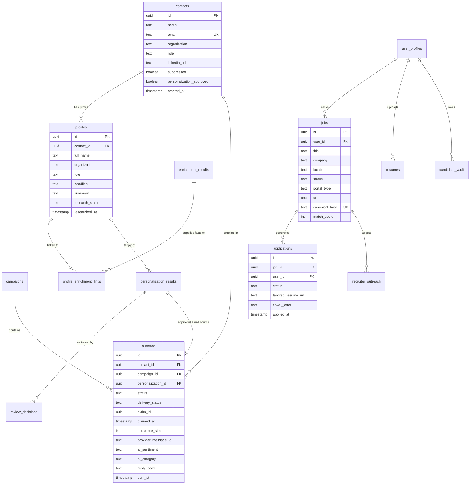

# College Outreach Automation V2 & CareerRizz: Master Specifications

**System Identity**: College Outreach Automation System V2 / CareerRizz  
**Version**: 2.0.0  
**Stack**: Node.js (Express ESM & Fastify), React 19 + TypeScript + Vite + Tailwind CSS v4, Supabase (Postgres + `pgvector`), BullMQ / node-cron, OpenAI API, Playwright, Chrome Extension MV3  
**Grounding Baseline**: Workspace repository commit history, `.freebuff/` state, `db/migrations/`, `src/`, `f/`, and `apps-monorepo/`. Zero external or ungrounded features.

---

# Table of Contents
1. [Business Requirements Document (BRD)](#1-business-requirements-document-brd)
   - 1.1 Executive Summary & Business Rationale
   - 1.2 Core Business Objectives & KPIs
   - 1.3 Stakeholder & User Personas
   - 1.4 Business Workflows & Value Streams
   - 1.5 Governance, Compliance & Business Rules
2. [Market Requirements Document (MRD)](#2-market-requirements-document-mrd)
   - 2.1 Market Landscape & Core Problem Statements
   - 2.2 Target Market Segments & Addressable Market
   - 2.3 Competitive Analysis & Structural Differentiation
   - 2.4 Grounded Feature Matrix vs. Market Alternatives
   - 2.5 Cost Structure & Zero-Cost Architecture Model
3. [Product Requirements Document (PRD)](#3-product-requirements-document-prd)
   - 3.1 Product Vision & Architecture Scope
   - 3.2 Access Control & Role-Based Access Control (RBAC)
   - 3.3 Module 1: Institutional & Academic Outreach Engine
   - 3.4 Module 2: Autonomous Career Intelligence & Application Engine
   - 3.5 Cross-Module Third-Party Integrations
   - 3.6 Frontend Console Specification (`f/` React 19 App)
   - 3.7 Non-Functional Product Requirements
4. [Technical Requirements Document (TRD)](#4-technical-requirements-document-trd)
   - 4.1 System Topology & Architectural Schematics
   - 4.2 Comprehensive Data Dictionary & Database Schema (27 Tables)
   - 4.3 REST API Endpoints & Route Registry
   - 4.4 Background Jobs, Concurrency & Locking Architecture
   - 4.5 Execution Subsystems: Playwright Bot & Chrome Extension Bridge
   - 4.6 AI & Semantic Search Pipeline Specifications
   - 4.7 Security Architecture, Authentication & Unsubscribe Cryptography
   - 4.8 Environment & Infrastructure Configuration

---

# 1. Business Requirements Document (BRD)

## 1.1 Executive Summary & Business Rationale
Modern institutional and outbound communications suffer from an escalating crisis: mass cold-email automation has saturated inboxes with low-effort generic templates, causing deliverability collapse, domain blacklisting, and sender burnout. Concurrently, the technical job search ecosystem has transformed into an automated Applicant Tracking System (ATS) "black hole" where human candidates spend dozens of hours manually re-entering resume data across fragmented portals (Greenhouse, Lever, Ashby, Workday) with sub-2% response rates.

**College Outreach Automation V2 / CareerRizz** solves both challenges by operating as an integrated, dual-workspace autonomous engine:
1. **Academic/Institutional Workspace**: Ingests unstructured academic directories and leads, extracts real-world evidence (publications, biographies, institutional news) from free public sources, drafts verified evidence-cited outreach, and executes rate-limited campaigns with automated inbound Gmail sentiment triage.
2. **Career & Candidate Workspace**: Programmatically discovers live job listings across ATS endpoints, performs semantic rubric-based resume matching with high-dimensional vector embeddings, dynamically formats ATS resumes using the Google XYZ formula, executes assisted and live bot applications via Playwright and Chrome Extension bridges, and detects inbound interview/rejection responses automatically.

## 1.2 Core Business Objectives & KPIs

| Objective | Baseline Metric | Target KPI (System Grounded) | Verification Source |
|---|---|---|---|
| **Eliminate Hallucinated Outreach** | 30–40% AI factual errors | 100% cited facts verified against OpenAlex/Wikipedia/DDG | `profile_enrichment_links` & `personalization_results.evidence_used` |
| **Protect Domain Sender Reputation** | Spikes > 100/hr causing ISP blocks | Hard daily caps (default: 10/day, configurable) with staggered delay jitter (2000ms) | `src/config/env.js`, `outreach.service.js` |
| **Human-in-the-Loop Quality Control** | Uncontrolled batch blast | 0 emails sent without explicit operator approval (`personalization_approved`) | `review_decisions`, `personalization.routes.js` |
| **ATS Ingestion & Application Speed** | 35–45 min/application manual entry | < 30 seconds via Playwright Desktop Bot or 1-click Extension autofill | `playwright-live-bot.js`, `content-autofill.js` |
| **Response Triage Latency** | Manual inbox checking 1–2x daily | 15-minute polling interval via Gmail OAuth with instant classification | `replies.job.js`, `reply.service.js` |

## 1.3 Stakeholder & User Personas

### Persona 1: College Admissions & Outreach Operator (`college_operator`)
- **Primary Need**: Outreach to professors, researchers, department chairs, and alumni for partnerships, speaker invitations, or academic programs.
- **Pain Points**: CSV/PDF lead sheets are poorly formatted; professors ignore generic emails; manual research takes 20 minutes per academic.
- **System Touchpoints**: `/dashboard`, `/import`, `/people`, `/research`, `/personalization`, `/review`, `/outreach`, `/replies`, `/alumni`.

### Persona 2: Technical Job Seeker / Candidate (`job_seeker`)
- **Primary Need**: Finding relevant software engineering and technical roles, tailoring resumes to job descriptions without fabricating skills, and tracking multi-stage application pipelines.
- **Pain Points**: Repetitive Workday/Greenhouse forms; ATS keyword screening rejections; losing track of recruiter correspondence.
- **System Touchpoints**: `/jobs/dashboard`, `/jobs/discovery`, `/jobs/research`, `/jobs/resume`, `/jobs/personalization`, `/jobs/applications`, `/jobs/recruiter`, `/jobs/vault`.

### Persona 3: Platform Superuser / Administrator (`owner`)
- **Primary Need**: Total oversight over delivery rates, queue health, system-wide integrations, and workspace switching.
- **Pain Points**: SMTP rate-limit bans, stale claimed jobs blocking sending queues, API key leakage.
- **System Touchpoints**: Settings, RBAC switcher, Integration health diagnostic endpoints, Manual trigger endpoints.

## 1.4 Business Workflows & Value Streams

```mermaid
flowchart TD
    subgraph Outreach_Stream["Institutional Outreach Stream"]
        O1[Lead Ingestion: CSV/XLSX/PDF/OCR] --> O2[Entity Profile Creation]
        O2 --> O3[Multi-Source Web Research: OpenAlex/Wiki/DDG]
        O3 --> O4[AI Personalization with Evidence Citation]
        O4 --> O5{Human Review Queue}
        O5 -- Rejected --> O6[Regenerate / Discard]
        O5 -- Approved --> O7[Rate-Limited SMTP Dispatch Engine]
        O7 --> O8[Inbound Reply Detection & Sentiment Triage]
    end

    subgraph Career_Stream["Career & Job Application Stream"]
        C1[ATS Discovery: Greenhouse/Lever/Ashby/Adzuna] --> C2[Canonical Deduplication Hash]
        C2 --> C3[pgvector Semantic Resume Matching & Scoring]
        C3 --> C4[Dynamic Google XYZ ATS Resume Generation]
        C4 --> C5{Execution Mode}
        C5 -- Assisted --> C6[Chrome Extension Autofill Bridge]
        C5 -- Live Desktop --> C7[Playwright Visible Browser Bot]
        C5 -- Background --> C8[24/7 Autopilot Policy Engine]
        C6 & C7 & C8 --> C9[ATS Reply Parsing & Pipeline Status Sync]
    end
```



## 1.5 Governance, Compliance & Business Rules
1. **CAN-SPAM & Opt-Out Enforcement**: Every outbound email dispatched through `outreach.service.js` must inject an HMAC-signed tokenized unsubscribe header (`List-Unsubscribe`) and footer link. Clicking `/unsubscribe?token=...` instantly writes to `suppressed_contacts` and flags `contacts.suppressed = true`. All subsequent queries filter out suppressed records.
2. **Deterministic Single-Campaign Lookups**: PostgREST single-row lookups must never rely on `.maybeSingle()` on non-unique columns, preventing race-condition campaign duplication.
3. **Strict Human Review Safety Gate**: By default, `approvePersonalization = false`. No AI draft is scheduled or sent without an explicit review decision row in `review_decisions` or explicit operator override in `/bulk/approve-and-send`.
4. **Data Isolation via RBAC**: The backend enforces module separation via `requireModule('outreach')` and `requireModule('job_search')`. `college_operator` accounts cannot read or write job search tables, preventing cross-tenant leakage.

---

# 2. Market Requirements Document (MRD)

## 2.1 Market Landscape & Core Problem Statements
The outbound automation market is bifurcated into high-volume sales cold emailers (e.g., Instantly, Lemlist, Apollo) and consumer job search chrome extensions (e.g., Simplify, Teal, Huntr). Both segments suffer from fundamental structural deficiencies:

1. **The "Template Spammer" Flaw**: Traditional sales tools rely on superficial liquid syntax tags (`{{firstName}}`, `{{companyName}}`). Modern email spam filters (Google Workspace and Microsoft 365) actively penalize templated outreach lacking unique syntactic structures.
2. **The "Hallucinating AI" Flaw**: Unconstrained LLM-generated emails fabricate mutual acquaintances, fake projects, or inaccurate company details, embarrassing the sender upon reply.
3. **The "Disconnected Silo" Flaw**: Job seekers use one tool to scrape jobs, a second to rewrite resumes with ChatGPT, a third spreadsheet to track applications, and their email inbox to catch replies manually.

## 2.2 Target Market Segments & Addressable Market
- **Higher Education & Research Institutes**: University admissions, career centers, corporate sponsorship offices, academic lab outreach directors.
- **Tech Professionals & High-Velocity Job Seekers**: Software engineers, AI researchers, and technical product managers navigating complex multi-stage ATS portals.
- **Alumni Relations & University Advancement Teams**: Discovering and engaging alumni networks on LinkedIn for mentorship, guest lectures, and endowment development.

## 2.3 Competitive Analysis & Structural Differentiation

| Capability | Generic Cold Email Tools (Instantly, Lemlist) | Job Search Extensions (Simplify, Teal) | CareerRizz / College Outreach V2 |
|---|---|---|---|
| **Research Enrichment** | Paid 3rd party credits (Apollo, Clearbit) | None (User inputs manually) | **Zero-cost native APIs**: OpenAlex (academic papers), Wikipedia, DuckDuckGo |
| **Evidence Traceability** | No evidence tracking | N/A | **Cryptographic/DB linkage**: Every sentence tied to a verified fact ID |
| **ATS Job Board Parsing** | Not supported | Client-side DOM scraping | **Official REST Adapters**: Greenhouse, Lever, Ashby, Adzuna + canonical deduplication |
| **Resume Matching Engine** | Not supported | Keyword matching (TF-IDF) | **pgvector Cosine Similarity** (1536-dim / 384-dim) + LLM Rubric Grading (0-100) |
| **Application Execution** | SMTP only | Form autofill script | **Triple execution**: 1-Click Direct, Playwright Desktop Bot (slow-mo), Chrome MV3 Extension |
| **Inbound Reply Triage** | Basic open/click/reply tracking | None | **Dual-purpose Gmail AI**: Sentiment triage + ATS domain status updates |

## 2.4 Grounded Feature Matrix vs. Market Alternatives

```mermaid
graph LR
    subgraph Market_Standard["Standard Market Tools"]
        M1[Generic CSV Upload]
        M2[Template {{variables}}]
        M3[Unthrottled Sending]
        M4[Manual Reply Reading]
    end

    subgraph CareerRizz_Workspace["CareerRizz Grounded Architecture"]
        C1[Multi-Format Parser: CSV/XLSX/PDF + Tesseract OCR]
        C2[Verifiable Fact Enrichment: OpenAlex / Wiki / DDG]
        C3[Daily Limit Caps + Claim Locking + Stale Claim Reclaim]
        C4[OpenAI Sentiment Classifier + ATS Status Auto-Transition]
    end

    M1 -.-> C1
    M2 -.-> C2
    M3 -.-> C3
    M4 -.-> C4
```

## 2.5 Cost Structure & Zero-Cost Architecture Model
A critical business requirement implemented throughout the codebase is **operational cost minimization**:
- **Enrichment**: OpenAlex (free open-access academic graph, no API key required), Wikipedia API (free open knowledge API), DuckDuckGo Lite (free web search without paid scrapers).
- **Database**: Supabase Free/Pro tier using native PostgreSQL with standard extensions (`pgcrypto`, `vector`, `pg_trgm`).
- **Email Delivery**: Brevo free tier (300 emails/day) or direct Mailtrap SMTP for development.
- **Authentication**: Built-in Supabase Auth GoTrue service (free tier up to 50,000 MAUs).
- **AI Token Gating**: Personalization uses structured JSON schemas with compact token usage (`gpt-4o-mini` for discovery/classification, `gpt-4o` for precision generation), controlled by `PERSONALIZATION_CONCURRENCY` (default: 5) and `RESEARCH_CONCURRENCY` (default: 3).

---

# 3. Product Requirements Document (PRD)

## 3.1 Product Vision & Architecture Scope
The product delivers a unified, reactive command center for outbound academic communication and automated career execution. The system features a single codebase hosting two fully realized modules, bound together by a unified React 19 UI console (`f/`), Supabase relational persistence, and shared background job daemons.

## 3.2 Access Control & Role-Based Access Control (RBAC)

### User Roles Defined in `user_profiles`
1. **`owner`**:
   - Access to both `outreach` and `job_search` modules.
   - Access to manual trigger endpoints (`/api/trigger/*`), integration health diagnostics, and administrative workspace switching.
   - Bypasses module isolation checks in `requireModule()`.
2. **`college_operator`**:
   - Strictly restricted to `outreach` routes (`/api/campaigns`, `/api/contacts`, `/api/outreach`, `/api/replies`, `/api/profiles`, `/api/import`, `/api/personalization`, `/api/alumni`).
   - Blocked by `requireModule('job_search')` with HTTP 403 Forbidden on job routes.
3. **`job_seeker`**:
   - Strictly restricted to `job_search` routes (`/api/jobs`, `/api/resumes`, `/api/applications`, `/api/recruiter-outreach`, `/api/candidate-vault`).
   - Blocked by `requireModule('outreach')` with HTTP 403 Forbidden on outreach routes.

### Workspace Context Switching
- Profile attribute `active_workspace` (`'outreach'` | `'job_search'`).
- Modifiable via `PUT /api/user/workspace` or `PUT /auth/profile/workspace`.
- Persisted in Supabase and cached in React `UserProfileContext`.

---

## 3.3 Module 1: Institutional & Academic Outreach Engine

### 3.3.1 Lead Ingestion & Normalization (`src/services/import.service.js`)
- **Accepted File Formats**: `.csv`, `.xlsx`, `.xls`, `.pdf`, `.png`, `.jpg`, `.jpeg`, `.webp`, `.bmp`.
- **Parsing Engines**:
  - `csv-parse`: Streaming delimiter-agnostic table extraction.
  - `xlsx`: Workbook sheet conversion to JSON.
  - `pdfjs-dist` & `pdf-parse`: Multi-page text layer extraction.
  - `tesseract.js`: Optical Character Recognition (OCR) for scanned PDFs and image screenshots of lead tables.
- **Field Normalization**: Heuristic column mapping detects Name (`full_name`, `contact_name`, `name`), Email (`email_address`, `mail`), Organization (`university`, `institution`, `college`, `company`), Role (`title`, `position`, `designation`), LinkedIn (`linkedin_url`, `profile_link`).
- **Idempotency**: Rows deduplicated by contact email; existing contacts updated without overwriting historical notes.
- **Async Execution**: Large imports processed via `import_jobs` table with polling via `GET /api/import/status/:jobId`.

### 3.3.2 Multi-Source Web & Academic Research (`src/services/research.service.js`)
- **Source 1: OpenAlex API (`https://api.openalex.org/works`)**:
  - Queries author publications by name and institution.
  - Extracts title, publication year, journal/venue, cited count, and DOI.
  - Saves verified academic facts into `enrichment_results`.
- **Source 2: Wikipedia REST API (`https://en.wikipedia.org/api/rest_v1/page/summary/`)**:
  - Resolves person biography and institution overview.
  - Extracts biographical extracts, disambiguated descriptions, and canonical URLs.
- **Source 3: DuckDuckGo Instant Answers & Lite HTML Fallback**:
  - Searches recent news, lab announcements, and press releases.
- **Identity Scoring**: `scoreIdentity()` cross-references institution name and domain to ensure research facts belong to the exact contact, assigning an `identity_confidence` score (0.00–1.00).

### 3.3.3 Evidence-Cited AI Personalization (`src/services/personalization.service.js`)
- **Prompt Structure**: Enforces strict structured output via OpenAI.
- **Evidence Traceability**: Prompt feeds enriched facts with explicit IDs (`[FACT-1]`, `[FACT-2]`). The LLM is instructed: *“Cite the exact fact ID used for every personalized claim. If no facts are present, generate a clean, honest introductory draft without making up achievements.”*
- **Database Output**: Writes to `personalization_results` with fields: `subject_line`, `body_content`, `evidence_used` (JSON array of fact IDs), `quality_score` (0–100), `status` (`'pending_review'`).

### 3.3.4 Human-in-the-Loop Review Queue (`f/src/pages/ReviewPage.tsx`)
- **Review Actions**:
  - **Approve**: Sets `status = 'approved'`, marks contact `personalization_approved = true`, queues outreach enrollment into `outreach` table with `status = 'Ready'`.
  - **Reject**: Sets `status = 'rejected'`, records operator rejection reason, clears outreach readiness.
  - **Edit & Approve**: Updates `subject_line` and `body_content` with operator's manual edits before approving.
  - **Bulk Approve & Send**: One-click approval of up to 50 pending drafts with automatic dispatch scheduling (`POST /api/bulk/approve-and-send`).

### 3.3.5 Rate-Limited Outbound SMTP Dispatch (`src/services/outreach.service.js`)
- **Concurrency & Jitter**: Enforces `outreach.smtpConcurrency` (default: 1) and `outreach.sendDelayMs` (default: 2000ms delay between dispatches).
- **Daily Volume Caps**: Checks count of messages sent within current 24-hour UTC window against `DAILY_SEND_LIMIT` (default: 10). If cap is reached, dispatch halts gracefully.
- **Two-Phase Claim Locking**:
  - Rows claimed by setting `claim_id = UUID`, `claimed_at = NOW()`, `status = 'Claimed'`.
  - Prevents race conditions during overlapping cron executions.
  - Stale claims automatically cleared by `cleanup-stale-claims.job.js` after 10 minutes.
- **Deliverability Headers**: Automatically generates `Message-ID`, `List-Unsubscribe`, `List-Unsubscribe-Post`, `X-Entity-Ref-ID`.

### 3.3.6 Automated Follow-Up Sequencing (`src/services/followup.service.js`)
- **Multi-Step Drip Logic**:
  - Step 0: Initial email sent.
  - Step 1: Follow-up #1 scheduled at `T + FOLLOWUP_1_DAYS` (default: 7 days) if no reply received and status is `'Sent'`.
  - Step 2: Follow-up #2 scheduled at `T + FOLLOWUP_2_DAYS` (default: 14 days) if still no reply.
  - Step 3: Sequence completed.
- **Suppression Check**: Bypasses any contact that has replied, unsubscribed, or bounced.

### 3.3.7 Inbound Reply Detection & Sentiment Classification (`src/services/reply.service.js`)
- **Gmail OAuth 2.0 Ingestion**: Queries Gmail API for inbound unread messages.
- **Thread & Header Matching**: Matches incoming replies to existing outreach records via (1) Gmail Thread ID, (2) `In-Reply-To` and `References` headers matching `provider_message_id`, (3) Sender email lookup, (4) Normalized subject matching.
- **AI Sentiment Classification**: OpenAI evaluates reply body and categorizes into:
  - `INTERESTED` (Positive meeting request or collaboration willingness)
  - `INFO_REQUESTED` (Questions regarding program, links, or schedule)
  - `NOT_INTERESTED` (Explicit declination)
  - `OUT_OF_OFFICE` (Automated auto-responder)
  - `OTHER` (Unclassified correspondence)
- **Outreach State Transition**: Sets outreach record `status = 'Replied'`, records `reply_body`, `ai_sentiment`, `ai_category`, `ai_summary`, and `ai_next_action`.

### 3.3.8 LinkedIn Alumni Discovery (`src/routes/alumni.routes.js`)
- **Apify Integration**: Triggers LinkedIn People Search scraper filtered by school/university name and geographic location.
- **Staging & Import**: Surfaces discovered alumni candidates in UI table. Operator selects candidates to import into contacts, profiles, and research queues.

---

## 3.4 Module 2: Autonomous Career Intelligence & Application Engine

### 3.4.1 Multi-ATS Job Discovery (`src/routes/job-search.routes.js`)
- **Supported ATS Endpoints**:
  - **Greenhouse**: `https://boards-api.greenhouse.io/v1/boards/{board_token}/jobs`
  - **Lever**: `https://api.lever.co/v0/postings/{company}`
  - **Ashby**: `https://api.ashbyhq.com/posting-api/job-board/{board_token}`
  - **Adzuna**: Search query API with location and salary parameters.
- **Canonical Hash Deduplication**: Computes MD5/SHA256 fingerprint from `lower(title) + lower(company) + lower(location)`. Prevents duplicate job records in `jobs` and `job_listings`.
- **Database Mapping**: Ingests job title, company, location, employment type, remote status, compensation range, job description HTML, and application portal URL.

### 3.4.2 Semantic Resume Vector Matching (`pgvector` + OpenAI)
- **Vector Projection**: Transforms candidate resume text and job description into 1536-dimensional semantic vectors (`text-embedding-3-small`) or 384-dimensional vectors (`BAAI/bge-small-en-v1.5`) stored in `job_embeddings` and `resumes`.
- **HNSW Cosine Distance**: Calculates semantic similarity using PostgreSQL HNSW index operator `<=>`.
- **Rubric-Based AI Grading (0–100 Score)**:
  - Skills Match (Weight: 40%): Hard technical skills, programming languages, toolsets.
  - Experience Match (Weight: 30%): Seniority, scope of responsibility, industry alignment.
  - Education & Certification Match (Weight: 15%): Degree requirements and certifications.
  - Location/Work Model Match (Weight: 15%): Remote vs. onsite compatibility.
  - Output: Returns overall match score, strengths list, gaps list, and actionable recommendations.

### 3.4.3 Dynamic Google XYZ ATS Resume Generator
- **Formula Standard**: Formats experience bullet points strictly to the Google XYZ structure: *"Accomplished [X], as measured by [Y], by doing [Z]"*.
- **ATS Compliance Formatting**: Single-column layout, plain-text typography, zero multi-column tables, zero graphics, FAANG-standard section headers (`Summary`, `Technical Skills`, `Experience`, `Education`, `Projects`).
- **Keyword Density Optimization**: Dynamically extracts high-value keywords from the job description and injects them naturally into relevant experience descriptions.
- **Scoring**: Computes ATS pass score (0–100) and displays keyword chips in `JobPersonalizationPage.tsx`.

### 3.4.4 AI Cover Letter & Recruiter Pitch Generation
- **Tone Profiles**:
  - `Professional`: Formal, enterprise-aligned, research-oriented.
  - `Conversational`: Warm, engaging, culturally collaborative.
  - `Technical`: Deep engineering focus, highlighting architecture, metrics, and scale.
  - `Punchy`: Concise, high-impact bulleted executive pitch.
- **Entity Context**: Automatically incorporates company research facts (tech stack, recent funding, product launches) into the cover letter draft.

### 3.4.5 Application Execution Subsystems

#### Option A: 1-Click Direct Apply
- Clicking *"Apply Direct"* in `JobDiscoveryPage.tsx` or `JobPersonalizationPage.tsx` records an application entry in `applications` (`status = 'applied'`) and opens the live portal URL in a new browser tab (`window.open(job.url, '_blank')`).

#### Option B: Live Desktop Playwright Bot (`POST /api/jobs/:id/apply-live`)
- **Execution Script**: `src/services/workers/execution/playwright-live-bot.js`.
- **Behavior**: Launches a visible, non-headless Chromium desktop window (`headless: false`, `slowMo: 40ms`).
- **Humanized Typing**: Types input field characters with a 50–150ms randomized cadence.
- **ATS DOM Detectors**: Automatically identifies standard form fields for Greenhouse, Lever, Ashby, and Workday:
  - First Name, Last Name, Full Name
  - Email, Phone Number
  - LinkedIn Profile URL, GitHub URL, Portfolio URL
  - Resume file attachment (`input[type="file"]`)
- **Safety Staging**: Fills all form fields and stages the submission button without clicking final submit (unless `autoSubmit = true` is explicitly configured).

#### Option C: Chrome Extension Auto-Filler Bridge (`src/extension/`)
- **Architecture**: Manifest V3 extension with `background.ts` service worker and `content-autofill.js` content script.
- **Domain Triggers**: Activates automatically on `*.greenhouse.io`, `*.lever.co`, `*.ashbyhq.com`, and `*.myworkdayjobs.com`.
- **UI Overlay**: Injects a floating, draggable *"Auto-Fill via CareerRizz"* button into the active ATS tab.
- **Communication Bridge**: Queries the local API (`http://localhost:5000/api/candidate-vault/query`) or pulls local candidate session data to populate input fields and match dropdown options.

#### Option D: 24/7 Autopilot Worker (`src/jobs/job-autopilot.job.js`)
- **Schedule**: Recurring 30-minute background daemon.
- **Workflow**:
  1. Scans connected job boards for new openings matching candidate search preferences.
  2. Runs semantic vector scoring against candidate profiles.
  3. Checks policy threshold (e.g., `matchScore >= 85` AND company not previously applied).
  4. Auto-queues application record and triggers application dispatch.
  5. Scans Gmail for new ATS replies and updates interview stages.

### 3.4.6 Inbound ATS Reply Parser & Pipeline Stage Transitions
- **ATS Sender Detection**: Identifies emails originating from ATS notification domains: `@greenhouse.io`, `@lever.co`, `@myworkday.com`, `@workday.com`, `@ashbyhq.com`, `@smartrecruiters.com`, `@icims.com`.
- **Subject & Body Pattern Matching**:
  - **Interview Request**: Matches strings (`interview`, `schedule`, `calendly.com`, `meet.google.com`, `zoom.us`, `availability`) $\rightarrow$ updates `applications.status = 'interview'`, `jobs.status = 'interviewing'`.
  - **Technical Assessment (OA)**: Matches strings (`hackerrank`, `codesignal`, `coding challenge`, `assessment`, `take-home`) $\rightarrow$ updates `applications.status = 'technical_round'`, `jobs.status = 'interviewing'`.
  - **Rejection**: Matches strings (`unfortunately`, `not moving forward`, `pursuing other candidates`, `not selected`) $\rightarrow$ updates `applications.status = 'rejected'`, `jobs.status = 'rejected'`.

---

## 3.5 Cross-Module Third-Party Integrations

### 3.5.1 Composio Unified Integration Bridge (`src/services/composio.service.js`)
- Provides user-scoped OAuth connection flows for Gmail and LinkedIn.
- Surfaces endpoints:
  - `GET /api/integrations/composio/gmail`: Connection status.
  - `POST /api/integrations/composio/gmail/connect`: Initiates OAuth link generation.
  - `GET /api/integrations/composio/gmail/inbox`: Fetches user inbox messages.
  - `GET /api/integrations/composio/linkedin`: Connection status.
  - `POST /api/integrations/composio/linkedin/connect`: Generates LinkedIn OAuth link.
  - `GET /api/integrations/composio/linkedin/me`: Fetches authenticated user's profile.
  - `GET /api/integrations/composio/linkedin/people/:personId`: Inspects prospect details.

---

## 3.6 Frontend Console Specification (`f/` React 19 App)

### 3.6.1 Route Inventory (23 Total Pages)

```text
f/src/pages/
├── LoginPage.tsx                  # Public /login
├── SignupPage.tsx                 # Public /signup
│
├── [Outreach Workspace Pages - Gated by ModuleGuard('outreach')]
│   ├── DashboardPage.tsx          # System KPI dials, recent activity, delivery charts
│   ├── PipelinePage.tsx           # Visual Kanban/Funnel of contact outreach states
│   ├── ImportPage.tsx             # Drag-drop file dropzone (CSV/XLSX/PDF/Img) + job tracker
│   ├── PeoplePage.tsx             # Contacts table with filtering, search, and profile modal
│   ├── PersonDetailPage.tsx       # Profile deep-dive: verified facts, timeline, raw research
│   ├── ResearchPage.tsx           # Batch research runner (OpenAlex/Wiki/DDG status)
│   ├── PersonalizationPage.tsx    # Evidence-cited draft viewer & regenerate controls
│   ├── ReviewPage.tsx             # Human review queue: Approve, Reject, Edit, Bulk Action
│   ├── OutreachPage.tsx           # Outbound queue, claim locks, deliverability logs
│   ├── RepliesPage.tsx            # Inbound reply feed with AI sentiment badges & response text
│   ├── CampaignsPage.tsx          # Campaign list, schedule configurations, and statistics
│   ├── CampaignDetailPage.tsx     # Single campaign management & enrolled contact list
│   ├── BulkSendPage.tsx           # Pre-flight check & 1-click batch sending trigger
│   └── AlumniPage.tsx             # LinkedIn alumni discovery search & 1-click lead import
│
└── [Job Search Workspace Pages - Gated by ModuleGuard('job_search')]
    ├── jobs/JobDashboardPage.tsx      # Job search funnel, autopilot toggle, recent responses
    ├── jobs/JobDiscoveryPage.tsx      # ATS board explorer, keyword filter, live bot trigger
    ├── jobs/JobResearchPage.tsx       # Company intelligence, tech stack, funding, culture
    ├── jobs/ResumeMatchPage.tsx       # Resume PDF upload, text extraction, 0-100 rubric grade
    ├── jobs/JobPersonalizationPage.tsx# Dual view: ATS Resume generator & 4-tone Cover Letter
    ├── jobs/ApplicationsPage.tsx      # Full application lifecycle tracking (Applied -> Interview)
    ├── jobs/RecruiterOutreachPage.tsx # Recruiter cold outreach queue & follow-up scheduler
    ├── jobs/FollowUpsPage.tsx         # Automated & manual application follow-up timeline
    ├── jobs/JobTrackingPage.tsx       # Visual Kanban tracking stage transitions
    └── jobs/CandidateVaultPage.tsx    # Semantic skill vault, experience blocks, query explorer
```

### 3.6.2 UI & Component Standards
- **Component Architecture**: Built with Radix UI headless primitives and Tailwind CSS v4.
- **Theme & Palette**: Dark-mode primary console utilizing slate/zinc neutrals (`bg-slate-950`, `border-slate-800`), indigo/violet brand accents (`indigo-500`, `violet-500`), and semantic status colors (`emerald-500` for approved/interested, `amber-500` for pending/followup, `rose-500` for rejected/suppressed).
- **Page Transitions**: Framer Motion animated route transitions with hardware-accelerated transforms (`motion.div` in `PageTransition.tsx`).

---

# 4. Technical Requirements Document (TRD)

## 4.1 System Topology & Architectural Schematics

```text
┌────────────────────────────────────────────────────────────────────────────────────────┐
│                                REACT 19 FRONTEND CONSOLE (f/)                          │
│     Radix UI Primitives · Tailwind v4 · Lucide Icons · Supabase Realtime Hook Sub      │
└───────────────────────────────────────────┬────────────────────────────────────────────┘
                                            │ HTTP / JSON (Axios/Fetch) + Bearer Token
                                            ▼
┌────────────────────────────────────────────────────────────────────────────────────────┐
│                              EXPRESS ESM BACKEND (src/server.js)                       │
│  Middleware: requireAuth (Supabase JWT), requireApiKey, requireModule (RBAC), CORS     │
│  Static Serving: Prefers f/dist -> frontend/dist -> public/                            │
└──────────────┬────────────────────────────┬────────────────────────────┬───────────────┘
               │                            │                            │
               ▼                            ▼                            ▼
┌──────────────────────────────┐ ┌──────────────────────────┐ ┌──────────────────────────┐
│   SUPABASE POSTGRES ENGINE   │ │     BACKGROUND DAEMONS   │ │   EXTERNAL APIS & SDKs   │
│ 27 Relational Tables         │ │  8 node-cron schedules:  │ │ OpenAI API (GPT-4o)      │
│ pgvector HNSW Index (1536d)  │ │  - send-outreach.job     │ │ Brevo SMTP (Nodemailer)  │
│ Row-Level Security (RLS)     │ │  - followups.job         │ │ Google Gmail OAuth2.0    │
│ UUID Primary Keys            │ │  - replies.job           │ │ OpenAlex Works API       │
│ Timestamp triggers           │ │  - airtable-sync.job     │ │ Wikipedia REST API       │
└──────────────────────────────┘ │  - cleanup-stale-claims   │ │ Playwright Chromium      │
                                 │  - import.job            │ │ Apify LinkedIn Scraper   │
                                 │  - personalization.job   │ │ Composio SDK             │
                                 │  - job-autopilot.job     │ └──────────────────────────┘
                                 └──────────────────────────┘
```

---

## 4.2 Comprehensive Data Dictionary & Database Schema (27 Tables)

All schema migrations live in `db/migrations/*.sql` and `db/supabase_all_in_one_setup.sql`.



### Complete Inventory of All 27 Database Tables

1. **`contacts`**: Core entity directory for academic and institutional outreach. Stores `name`, `email` (unique index), `organization`, `role`, `linkedin_url`, `suppressed` (boolean flag), and `personalization_approved` (boolean safety gate).
2. **`campaigns`**: Outreach container storing campaign `name`, `subject_template`, `body_template`, `status` (`Draft`, `Active`, `Paused`, `Completed`), and configuration settings.
3. **`profiles`**: Rich academic/person profile linked to `contact_id` (foreign key). Holds scraped bio, `headline`, `organization`, `research_status` (`pending`, `queued`, `enriching`, `completed`, `failed`), and `researched_at`.
4. **`enrichment_sources`**: Registry of intelligence providers: `name` (`openalex`, `wikipedia`, `duckduckgo`, `linkedin`), `base_url`, `rate_limit_per_minute`, and operational status.
5. **`enrichment_results`**: Normalized factual assertions extracted from external APIs. Stores `source_id`, `external_id`, `fact_type` (`publication`, `bio`, `news`, `experience`), `title`, `snippet`, `raw_payload` (JSONB), and `confidence_score`.
6. **`profile_enrichment_links`**: Many-to-many junction table mapping `profile_id` to `enrichment_result_id`, establishing verifiable fact ownership.
7. **`personalization_results`**: Drafts generated by AI personalization engine. Stores `profile_id`, `campaign_id`, `subject_line`, `body_content`, `evidence_used` (JSONB array of cited fact IDs), `quality_score`, and review `status` (`pending_review`, `approved`, `rejected`).
8. **`review_decisions`**: Audit log of human operator review decisions. Stores `personalization_id`, `decided_by` (foreign key to `contacts.id`), `decision` (`approve`, `reject`, `edit_and_approve`), `comments`, and before/after edits.
9. **`outreach`**: Central transaction table managing outbound dispatch state. Contains `contact_id`, `campaign_id`, `personalization_id`, `status` (`Ready`, `Claimed`, `Sent`, `Replied`, `Failed`, `Bounced`, `Suppressed`), `claim_id` (UUID), `claimed_at`, `sequence_step` (0, 1, 2), `delivery_status` (`Pending`, `Delivered`, `Opened`, `Clicked`), `provider_message_id`, `gmail_thread_id`, `ai_category`, `ai_sentiment`, and `reply_body`.
10. **`processed_gmail_messages`**: High-water mark deduplication table storing `message_id` (primary key) and `processed_at` timestamp. Prevents duplicate ingestion of inbox emails.
11. **`import_jobs`**: Asynchronous file ingestion tracker. Records `filename`, `file_type`, `total_rows`, `processed_rows`, `created_count`, `updated_count`, `error_count`, `status` (`queued`, `processing`, `completed`, `failed`), and `error_log` (JSONB).
12. **`user_profiles`**: RBAC and application session store. Maps Supabase Auth `user_id` to `role` (`owner`, `college_operator`, `job_seeker`), `enabled_modules` (text array: `['outreach']`, `['job_search']`, or `['outreach', 'job_search']`), and `active_workspace`.
13. **`jobs`**: User-scoped opportunity tracking table. Stores `user_id`, `title`, `company`, `location`, `url`, `portal_type` (`greenhouse`, `lever`, `ashby`, `workday`), `salary_range`, `status` (`discovered`, `researching`, `applying`, `applied`, `interviewing`, `rejected`, `offered`), `match_score`, `notes`, and `canonical_hash`.
14. **`applications`**: Concrete job application instances. Stores `job_id`, `user_id`, `status` (`draft`, `ready`, `applied`, `interview`, `technical_round`, `rejected`, `offer`), `tailored_resume_url`, `cover_letter`, `notes`, and `applied_at`.
15. **`recruiter_outreach`**: Cold outreach direct to hiring managers and recruiters. Stores `user_id`, `job_id`, `recruiter_name`, `recruiter_email`, `recruiter_linkedin`, `channel` (`email`, `linkedin`), `status` (`draft`, `sent`, `replied`), and `sent_at`.
16. **`resumes`**: Master and tailored candidate resume store. Stores `user_id`, `filename`, `file_url`, `extracted_text`, `skills` (text array), and semantic `embedding` vector.
17. **`candidate_vault`**: Atomic candidate profile records for semantic matching and automated form filling. Stores `user_id`, `category` (`experience`, `project`, `skill`, `education`, `metric`), `content`, `tags` (text array), and metadata.
18. **`candidate_profiles`**: Enterprise monorepo candidate configuration table. Stores search preferences, target titles, target locations, minimum salary, and `autopilot_enabled` boolean flag.
19. **`job_listings`**: Global aggregated job repository (enterprise monorepo). Stores de-duplicated listings parsed by discovery workers across all platforms with full job description text and structured requirements.
20. **`job_sources`**: External job board registry tracking adapter performance, fetch frequencies, error counts, and rate limits.
21. **`job_snapshots`**: Point-in-time DOM / text snapshots of live job postings to detect description edits or posting closures.
22. **`job_research`**: Company-level intelligence reports generated by background research workers (tech stack, funding rounds, culture tags).
23. **`job_matches`**: Junction table storing semantic similarity and rubric grading between a `candidate_profile` and a `job_listing`. Contains `overall_score`, `skills_score`, `experience_score`, and explanation JSONB.
24. **`agent_runs`**: Orchestrator execution logs tracking agent execution runtime, token consumption, status, and failure stack traces.
25. **`audit_log`**: System-wide security and mutation audit trail recording user ID, action name, target table, row ID, and timestamp.
26. **`source_configs`**: Dynamic configuration overrides for scrapers and API adapters (user agents, headers, concurrency limits).
27. **`job_embeddings`**: Vector table indexing job listings with `vector(384)` / `vector(1536)` columns with HNSW cosine distance indexes.

---

## 4.3 REST API Endpoints & Route Registry

All routes mounted under `/api` require authentication via Supabase JWT or `x-api-key`. Development environments support `x-bypass-auth: true` when `NODE_ENV === 'development'`.

### Module 1: Institutional Outreach Routes (`requireModule('outreach')`)

| Method | Endpoint | Handler File | Description & Payload |
|---|---|---|---|
| `POST` | `/api/import` | `import.routes.js` | Multipart file upload (`file`). Queues asynchronous lead ingestion job. |
| `GET` | `/api/import/jobs` | `import.routes.js` | Returns array of recent import jobs with processed counts. |
| `GET` | `/api/import/status/:jobId` | `import.routes.js` | Polls progress and row-level errors for a specific import job. |
| `POST` | `/api/import/process` | `import.routes.js` | Synchronously triggers immediate processing of next pending import. |
| `GET` | `/api/campaigns` | `dashboard.routes.js` | Retrieves all outreach campaigns with recipient counts. |
| `GET` | `/api/contacts` | `dashboard.routes.js` | Paginated search of contacts with suppression and approval states. |
| `GET` | `/api/outreach` | `dashboard.routes.js` | Retrieves outreach records with delivery and reply statuses. |
| `GET` | `/api/replies` | `dashboard.routes.js` | Retrieves all received email replies with AI sentiment classification. |
| `GET` | `/api/dashboard/stats` | `dashboard.routes.js` | Returns aggregate counts: total leads, sent, replies, bounces, charts. |
| `GET` | `/api/profiles` | `dashboard.routes.js` | Lists enriched profiles with associated fact counts. |
| `GET` | `/api/enrichment/:profileId` | `dashboard.routes.js` | Returns all facts linked to a profile with source citations. |
| `GET` | `/api/research/status` | `dashboard.routes.js` | Returns status of background research worker queue. |
| `GET` | `/api/research/:profileId` | `dashboard.routes.js` | Retrieves research summary for a single profile. |
| `POST` | `/api/research/:profileId/run`| `dashboard.routes.js` | Triggers synchronous OpenAlex/Wiki/DDG research run on profile. |
| `POST` | `/api/research/run` | `dashboard.routes.js` | Queues batch research for all unresearched profiles. |
| `POST` | `/api/personalization/generate/:profileId` | `personalization.routes.js` | Triggers OpenAI personalization draft using cited evidence. |
| `GET` | `/api/personalization/:id/evidence` | `personalization.routes.js` | Returns exact fact objects cited in a specific draft. |
| `PUT` | `/api/personalization/regenerate` | `personalization.routes.js` | Discards draft and re-runs LLM generation (`{ profileId, campaignId }`). |
| `GET` | `/api/review/queue` | `personalization.routes.js` | Fetches pending drafts waiting for human operator review. |
| `POST` | `/api/review/:personalizationId` | `personalization.routes.js` | Submits operator decision (`decision: 'approve' \| 'reject' \| 'edit'`). |
| `POST` | `/api/bulk/approve-and-send` | `personalization.routes.js` | Bulk approves up to 50 drafts and sets outreach status to `'Ready'`. |
| `GET` | `/api/bulk/progress` | `personalization.routes.js` | Returns progress of current bulk approve-and-send operation. |
| `POST` | `/api/alumni/discover` | `alumni.routes.js` | Queries Apify LinkedIn scraper (`{ school, maxResults, location }`). |
| `POST` | `/api/alumni/import` | `alumni.routes.js` | Ingests selected alumni as contacts and profiles (`{ school, candidates }`). |

### Module 2: Career Intelligence & Job Search Routes (`requireModule('job_search')`)

| Method | Endpoint | Handler File | Description & Payload |
|---|---|---|---|
| `GET` | `/api/jobs` | `job-search.routes.js` | Lists tracked jobs with status, match scores, and portal types. |
| `POST` | `/api/jobs` | `job-search.routes.js` | Adds new job opportunity (`{ title, company, url, portalType }`). |
| `GET` | `/api/jobs/:id` | `job-search.routes.js` | Retrieves single job details including raw job description HTML. |
| `PATCH` | `/api/jobs/:id` | `job-search.routes.js` | Updates job status, notes, or salary details. |
| `DELETE`| `/api/jobs/:id` | `job-search.routes.js` | Deletes job opportunity and associated applications. |
| `POST` | `/api/jobs/discover` | `job-search.routes.js` | Scrapes Greenhouse/Lever/Ashby APIs for openings matching criteria. |
| `POST` | `/api/jobs/:id/research` | `job-search.routes.js` | Scrapes company intelligence (tech stack, funding, culture). |
| `POST` | `/api/resumes/upload` | `job-search.routes.js` | Multipart upload (`resume` PDF). Extracts text via `pdfjs-dist`. |
| `GET` | `/api/resumes` | `job-search.routes.js` | Lists candidate resumes with extracted text and skill tags. |
| `DELETE`| `/api/resumes/:id` | `job-search.routes.js` | Deletes resume record and associated vector embeddings. |
| `POST` | `/api/jobs/:id/match` | `job-search.routes.js` | Evaluates 0–100 rubric match score between resume and job description. |
| `POST` | `/api/jobs/:id/personalize` | `job-search.routes.js` | Generates bespoke cover letter in 1 of 4 tones (`{ tone }`). |
| `POST` | `/api/jobs/:id/generate-ats-resume` | `job-search.routes.js` | Generates FAANG-standard ATS resume with Google XYZ bullet points. |
| `POST` | `/api/jobs/:id/apply-direct` | `job-search.routes.js` | Records application submission and returns live application URL. |
| `POST` | `/api/jobs/:id/apply-live` | `job-search.routes.js` | Launches visible Chromium Playwright bot to auto-fill ATS form. |
| `POST` | `/api/jobs/autopilot/run` | `job-search.routes.js` | Manually triggers 1 cycle of autonomous discover-match-apply worker. |
| `GET` | `/api/applications` | `job-search.routes.js` | Lists active job applications with interview stages. |
| `POST` | `/api/applications` | `job-search.routes.js` | Creates new application tracking row. |
| `PATCH` | `/api/applications/:id` | `job-search.routes.js` | Updates application stage (`applied`, `interview`, `rejected`). |
| `GET` | `/api/recruiter-outreach` | `job-search.routes.js` | Lists cold outreach correspondence with hiring managers. |
| `POST` | `/api/recruiter-outreach` | `job-search.routes.js` | Drafts or records outreach email to recruiter. |
| `GET` | `/api/candidate-vault` | `job-search.routes.js` | Lists all atomic skill/experience blocks in candidate vault. |
| `POST` | `/api/candidate-vault` | `job-search.routes.js` | Adds new atomic experience/project block (`{ category, content }`). |
| `POST` | `/api/candidate-vault/query` | `job-search.routes.js` | Semantic vector search across candidate vault for form fields. |
| `GET` | `/api/job-stats` | `job-search.routes.js` | Returns job funnel counts and recent ATS company responses. |
| `GET` | `/api/job-timeline` | `job-search.routes.js` | Returns historical event stream of job status transitions. |

### System & Administrative Routes

| Method | Endpoint | Handler File | Description & Payload |
|---|---|---|---|
| `GET` | `/health` | `server.js` | Public uptime, version, and integration connectivity status. |
| `POST` | `/auth/signup` | `auth.routes.js` | Creates new Supabase Auth user and initializes `user_profiles`. |
| `POST` | `/auth/login` | `auth.routes.js` | Authenticates user credentials and returns session tokens. |
| `GET` | `/auth/me` | `auth.routes.js` | Returns currently authenticated user and active role. |
| `GET` | `/auth/profile` | `auth.routes.js` | Retrieves user profile, enabled modules, and active workspace. |
| `PUT` | `/auth/profile/workspace` | `auth.routes.js` | Switches active workspace (`workspace: 'outreach' \| 'job_search'`). |
| `GET` | `/auth/google` | `server.js` | Initiates Google OAuth 2.0 flow for Gmail inbox monitoring. |
| `GET` | `/auth/google/callback` | `server.js` | Exchanges Google auth code for refresh tokens. |
| `GET` | `/unsubscribe` | `server.js` | Processes cryptographic unsubscribe link from outbound emails. |
| `POST` | `/api/trigger/outreach` | `server.js` | Manual trigger for rate-limited outreach dispatch batch. |
| `POST` | `/api/trigger/followups` | `server.js` | Manual trigger for automated follow-up sequencing batch. |
| `POST` | `/api/trigger/replies` | `server.js` | Manual trigger for Gmail inbox reply scan and AI classification. |
| `POST` | `/api/trigger/replies/reset` | `server.js` | Clears `processed_gmail_messages` and re-scans entire inbox. |
| `POST` | `/api/trigger/personalization` | `server.js` | Manual trigger for batch AI draft generation. |
| `POST` | `/api/trigger/cleanup-stale-claims` | `server.js` | Reclaims outreach rows locked by crashed workers. |
| `POST` | `/api/trigger/airtable-sync` | `server.js` | Triggers bidirectional sync between Supabase and Airtable. |

---

## 4.4 Background Jobs, Concurrency & Locking Architecture

All scheduled background daemons are registered in `src/server.js` using `node-cron`.

| Job Daemon | Source File | Cron Expression | Execution Mechanics & Concurrency Rules |
|---|---|---|---|
| **Outreach Dispatch** | `send-outreach.job.js` | `*/2 * * * *` (Every 2 min) | Acquires two-phase claim lock on up to `DAILY_SEND_LIMIT` records where `status = 'Ready'`. Executes sequentially with `SEND_DELAY_MS` (2000ms) jitter. Halts if daily cap reached. |
| **Follow-Up Sequencer** | `followups.job.js` | `0 */6 * * *` (Every 6 hrs) | Finds sent outreach older than 7 or 14 days without replies. Evaluates sequence template and queues Step 1 / Step 2 drafts. |
| **Reply Checker** | `replies.job.js` | `*/15 * * * *` (Every 15 min) | Connects to Gmail API, fetches unread inbox messages, filters out already-processed IDs, matches against outreach/jobs, and runs OpenAI sentiment classification. |
| **Airtable Sync** | `airtable-sync.job.js` | `0 * * * *` (Hourly) | Syncs state from Supabase `outreach` to configured Airtable base. Read-only mirror for non-technical stakeholders. |
| **Stale Claim Cleanup**| `cleanup-stale-claims.job.js`| `*/10 * * * *` (Every 10 min) | Queries `outreach` for rows with `status = 'Claimed'` and `claimed_at < NOW() - 10 minutes`. Resets `status = 'Ready'`, `claim_id = null`. |
| **Import Processing** | `import.job.js` | `*/5 * * * *` (Every 5 min) | Picks up `queued` rows in `import_jobs`. Parses file buffers, normalizes columns, and batch inserts contacts and profiles. |
| **Personalization Engine** | `personalization.job.js` | `*/30 * * * *` (Every 30 min) | Scans for profiles missing personalization drafts. Triggers research if unresearched, then calls OpenAI with concurrency cap (`PERSONALIZATION_CONCURRENCY: 5`). |
| **Career Autopilot** | `job-autopilot.job.js` | `*/30 * * * *` (Every 30 min) | Discovers live ATS openings across Greenhouse, Lever, and Ashby; scores against candidate profiles; auto-applies to high-match roles; checks inbound replies. |

---

## 4.5 Execution Subsystems: Playwright Bot & Chrome Extension Bridge

### Playwright Live Desktop Bot (`src/services/workers/execution/playwright-live-bot.js`)
- **Engine**: Playwright Chromium driver.
- **Visual Desktop Mode**: Runs with `headless: false` and `slowMo: 40`, enabling the user to watch the browser navigate, scroll, type, and attach files live on screen.
- **Bypass Flags**: Launches with `--disable-blink-features=AutomationControlled` and custom desktop user-agent to bypass basic automated bot detection.
- **Selector Heuristics**:
  - `input[name*="first_name" i], input[id*="first_name" i]`
  - `input[name*="email" i], input[type="email"]`
  - `input[name*="phone" i], input[type="tel"]`
  - `input[type="file"][accept*="pdf" i]`
- **Safety Gate**: Stops prior to clicking the final submit button (`button[type="submit"]`), leaving the form fully populated for final user inspection unless explicit `autoSubmit: true` is passed.

### Chrome Extension Manifest V3 Bridge (`src/extension/`)
- **Manifest**: Permissions include `alarms`, `tabs`, `scripting`, `activeTab`, `storage`.
- **Content Script (`content-autofill.js`)**: Matches URL patterns:
  - `https://*.greenhouse.io/*`
  - `https://*.lever.co/*`
  - `https://*.ashbyhq.com/*`
  - `https://*.myworkdayjobs.com/*`
- **DOM Injection**: Injects an isolated shadow-root or floating UI widget in the bottom-right corner of supported job portals.
- **Auto-Fill Action**: On click, queries candidate data via background service worker, maps candidate fields to active DOM inputs, triggers native `input` and `change` events, and attaches stored resumes.

---

## 4.6 AI & Semantic Search Pipeline Specifications

### LLM Gating & Models
- **Outreach Personalization**: `OPENAI_MODEL` (default: `gpt-4o`). Structured JSON schema output enforcing cited fact IDs.
- **Reply Sentiment Classifier**: `gpt-4o-mini` with strict categorization prompt. Returns `category`, `confidence`, `sentiment`, `summary`, `nextAction`, `suggestedFollowUpDate`, and `requiresHumanReview`.
- **ATS Resume Bullet Optimization**: Transforms raw candidate project descriptions into Google XYZ impact statements with dynamic keyword insertion.

### Vector Embeddings & Similarity Matching
- **Model**: OpenAI `text-embedding-3-small` (1536 dimensions) or local BGE `BAAI/bge-small-en-v1.5` (384 dimensions).
- **Index Specification**:
  ```sql
  CREATE INDEX IF NOT EXISTS idx_job_embeddings_hnsw 
  ON job_embeddings USING hnsw (embedding vector_cosine_ops);
  ```
- **Similarity Query**: Uses cosine distance operator `<=>` ordered ascending to retrieve nearest candidate experiences:
  ```sql
  SELECT id, title, company, 1 - (embedding <=> $1) AS similarity_score
  FROM job_embeddings
  WHERE 1 - (embedding <=> $1) > 0.75
  ORDER BY similarity_score DESC
  LIMIT 10;
  ```

---

## 4.7 Security Architecture, Authentication & Unsubscribe Cryptography

### API Security & Middleware Chain
1. **`requireAuth`**: Validates Supabase JWT Bearer token extracted from `Authorization: Bearer <token>` header. Populates `req.user`.
2. **`requireApiKey`**: Validates `x-api-key` header against `ADMIN_API_KEY`.
3. **`x-bypass-auth`**: Development escape hatch. **Strictly disabled in production**:
   ```javascript
   if (config.env === 'development' && req.headers['x-bypass-auth'] === 'true') {
     return next();
   }
   ```
4. **`requireModule(moduleName)`**: Reads user's role and enabled modules from `user_profiles`. Rejects unauthorized cross-workspace requests with HTTP 403 Forbidden.

### Cryptographic Unsubscribe System
- **Generation**: Creates HMAC SHA-256 JWT using `UNSUBSCRIBE_JWT_SECRET`:
  ```javascript
  jwt.sign({ contactId: contact.id, email: contact.email }, config.security.unsubscribeJwtSecret, { expiresIn: '90d' });
  ```
- **Verification**: `GET /unsubscribe?token=...` verifies signature and payload. If valid, marks contact `suppressed = true` and records reason in `suppressed_contacts`.
- **Headers Injected**:
  ```text
  List-Unsubscribe: <http://localhost:5000/unsubscribe?token=...>, <mailto:unsubscribe@domain.com?subject=unsubscribe:...>
  List-Unsubscribe-Post: List-Unsubscribe=One-Click
  ```

---

## 4.8 Environment & Infrastructure Configuration

### Environment Variables Catalog (`src/config/env.js`)

| Key | Required | Default Value | Purpose |
|---|---|---|---|
| `PORT` | No | `5000` | Express HTTP server listening port |
| `NODE_ENV` | No | `'development'` | Environment mode (`'development'` \| `'production'`) |
| `BASE_URL` | No | `'http://localhost:5000'` | Base public URL for callbacks and unsubscribe links |
| `SUPABASE_URL` | **Yes** | `''` | Supabase Postgres project API URL |
| `SUPABASE_SERVICE_KEY` | **Yes** | `''` | Supabase Service Role key (bypasses RLS) |
| `SUPABASE_ANON_KEY` | **Yes** | `''` | Supabase public anonymous API key |
| `AIRTABLE_TOKEN` | No | `''` | Personal access token for Airtable sync |
| `AIRTABLE_BASE_ID` | No | `''` | Base ID for Airtable sync |
| `AIRTABLE_TABLE_NAME` | No | `'Outreach'` | Target table name in Airtable base |
| `SMTP_HOST` | **Yes** | `'smtp.mailtrap.io'` | Outbound SMTP relay hostname (Brevo/Mailtrap) |
| `SMTP_PORT` | **Yes** | `587` | SMTP relay port (587 or 465) |
| `SMTP_SECURE` | No | `'false'` | Use TLS immediately on connect |
| `SMTP_USER` | **Yes** | `''` | SMTP authentication username |
| `SMTP_PASS` | **Yes** | `''` | SMTP authentication password |
| `MAIL_FROM_EMAIL` | **Yes** | `'shahid@gmail.com'` | Sender email address appearing in `From` header |
| `MAIL_FROM_NAME` | No | `'Shahid'` | Friendly sender name |
| `GMAIL_CLIENT_ID` | No | `''` | Google Cloud OAuth 2.0 client ID |
| `GMAIL_CLIENT_SECRET` | No | `''` | Google Cloud OAuth 2.0 client secret |
| `GMAIL_REDIRECT_URI` | No | `'http://localhost:5000/auth/google/callback'` | OAuth redirect callback URI |
| `GMAIL_REFRESH_TOKEN` | No | `''` | Offline refresh token for Gmail API inbox polling |
| `OPENAI_API_KEY` | **Yes** | `''` | OpenAI API key for personalization & embeddings |
| `OPENAI_MODEL` | No | `'gpt-4o'` | Model selection for personalization drafts |
| `DAILY_SEND_LIMIT` | No | `10` | Maximum outreach emails allowed per 24-hour UTC day |
| `FOLLOWUP_1_DAYS` | No | `7` | Days to wait before triggering Step 1 follow-up |
| `FOLLOWUP_2_DAYS` | No | `14` | Days to wait before triggering Step 2 follow-up |
| `SEND_DELAY_MS` | No | `2000` | Pacing delay in milliseconds between SMTP sends |
| `SMTP_CONCURRENCY` | No | `1` | Max parallel SMTP sockets during dispatch |
| `PERSONALIZATION_CONCURRENCY` | No | `5` | Max concurrent OpenAI completion requests |
| `RESEARCH_CONCURRENCY` | No | `3` | Max concurrent public web research requests |
| `APIFY_TOKEN` | No | `''` | API token for Apify LinkedIn alumni scraper |
| `COMPOSIO_API_KEY` | No | `''` | API key for Composio unified integration bridge |
| `ADMIN_API_KEY` | No | `'dev_admin_key_123'` | Static API key for administrative route access |
| `UNSUBSCRIBE_JWT_SECRET` | No | `'super_secret_unsubscribe_jwt_key'` | HMAC secret for signing unsubscribe tokens |
| `WEBHOOK_SECRET` | No | `'webhook_secret_key'` | Verification secret for incoming email provider webhooks |

### Verification & Testing Commands
- **Backend Syntax Check**: `node --check src/server.js`
- **Backend Smoke & Unit Verification**: `node test-verification.js`
- **Automated Test Suite**: `npm test` (`test/careerrizz-core.test.js`, `test/composio.test.js`)
- **End-to-End Pipeline Regression**: `node .e2e-pipeline.mjs` (Requires local server on `:5001`)
- **Frontend Typecheck & Production Build**: `cd f && npm run build` (Outputs clean bundle to `f/dist`)
