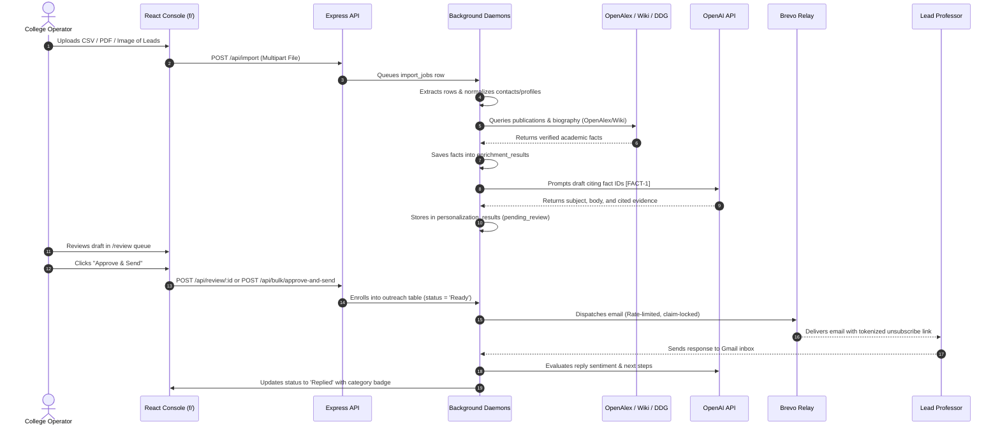
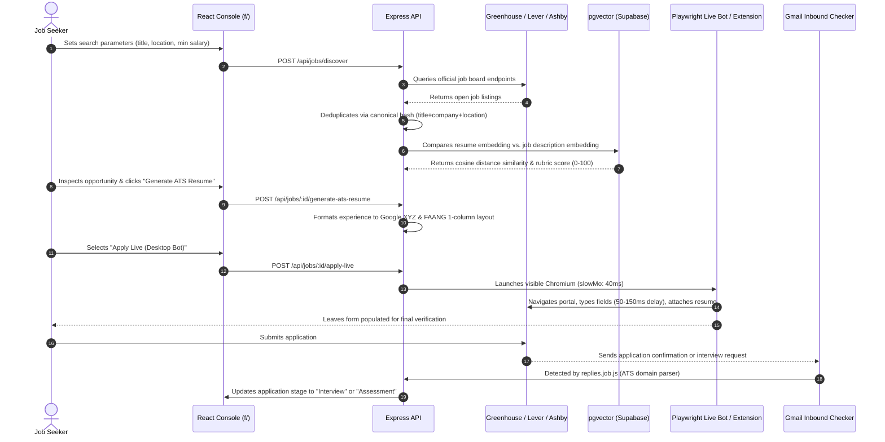

# Business Requirements Document (BRD)

**Project Name**: College Outreach Automation System V2 & CareerRizz  
**Document Version**: 2.0.0  
**Status**: Approved & Grounded to Workspace Baseline  
**Target Systems**: Outbound Academic Outreach Engine & Autonomous Career Application Platform  

---

## 1. Executive Summary & Strategic Rationale

Modern institutional and candidate communications face systemic operational failure:
1. **Academic Outreach Degradation**: Mass cold-email blast tools rely on superficial liquid syntax (`{{firstName}}`, `{{university}}`). Faculty and research directors receive dozens of templated inquiries weekly, resulting in spam flagging, sender domain blacklisting, and sub-3% response rates.
2. **Technical Recruitment "Black Hole"**: Technical job candidates face fragmented Applicant Tracking Systems (ATS) including Greenhouse, Lever, Ashby, and Workday. Each application requires 30–45 minutes of manual resume transcription, resulting in application fatigue, missed opportunities, and zero visibility into recruiter feedback.

**College Outreach Automation V2 / CareerRizz** provides a unified, dual-workspace autonomous platform built on Node.js, Express ESM, Fastify, React 19, and Supabase Postgres. The platform establishes:
- **For Higher Education Operators**: An automated lead ingestion and factual verification pipeline that pulls academic publications and career profiles from free public sources (OpenAlex, Wikipedia, DuckDuckGo), drafts evidence-backed personalized emails, enforces a human review safety gate, and dispatches via rate-limited SMTP while monitoring inbound replies using AI sentiment classification.
- **For Career Candidates**: An autonomous job intelligence engine that discovers live listings across official ATS APIs, evaluates resume fit via high-dimensional vector embeddings (`pgvector`), dynamically generates ATS resumes adhering to FAANG standards and Google XYZ formulas, executes automated applications via Playwright and Chrome Extension bridges, and tracks interview/rejection outcomes through Gmail reply triage.

---

## 2. Business Problem Statement & Market Drivers

| Business Problem | Operational Impact | Solution Grounded in System Codebase |
|---|---|---|
| **AI Hallucinations in Outreach** | Fabricating papers or mutual contacts burns institutional trust and damages sender reputation. | **Cryptographic Evidence Citation**: Personalization engine (`src/services/personalization.service.js`) only cites verified fact IDs from `enrichment_results` extracted from OpenAlex and Wikipedia. |
| **Domain Blacklisting & ISP Bans** | Sending 100+ emails/hr from un-warmed domains triggers spam blocks on Google and Microsoft 365. | **Hard Rate Limiting & Two-Phase Locking**: Strict daily limits (`DAILY_SEND_LIMIT = 10`), 2000ms delay jitter, and concurrency limits (`SMTP_CONCURRENCY = 1`). |
| **High Subscription & Credit Costs** | Apollo/Clearbit enrichment tools charge $0.20–$0.50 per verified lead credit. | **Zero-Cost Data Sourcing**: Native integration with OpenAlex Works API (free open-access academic corpus), Wikipedia REST API, and DuckDuckGo Lite. |
| **ATS Form Fatigue** | Re-entering employment history across 100+ separate ATS portals takes 60+ hours per month. | **Triple Application Execution**: 1-Click Direct URL launch, Playwright visible desktop bot (`playwright-live-bot.js`), and Chrome MV3 Extension (`content-autofill.js`). |
| **Manual Reply Triage Overhead** | Sifting through inboxes to identify positive leads or interview invites takes 1–2 hours daily. | **Automated Gmail Ingestion & AI Sentiment Classification**: `replies.job.js` polls Gmail every 15 min, classifying replies into `INTERESTED`, `INFO_REQUESTED`, `NOT_INTERESTED`, `MEETING_REQUEST`, or `OUT_OF_OFFICE`. |

---

## 3. Project Scope

### 3.1 In-Scope Business Capabilities (Strictly Grounded in Code)
- **Multi-Format Lead Ingestion**: Automated parsing of CSV, XLSX, PDF, and image screenshots (via Tesseract.js OCR) into normalized contacts and academic profiles.
- **Zero-Cost Fact Enrichment**: Automated retrieval of scholarly publications (OpenAlex), biographical summaries (Wikipedia), and web press (DuckDuckGo).
- **Evidence-Cited AI Personalization**: OpenAI-driven draft generation citing verified fact IDs with quality scoring (0–100).
- **Human-in-the-Loop Review Queue**: Dedicated web UI allowing operators to approve, reject, edit-and-approve, or bulk-schedule drafts.
- **Rate-Limited Dispatch Pipeline**: Nodemailer SMTP (Brevo relay) with daily caps, claim-locking, stale-claim recovery, and tokenized HMAC unsubscribe handling.
- **Automated Drip Follow-Up Sequencing**: Multi-step follow-ups scheduled at 7 and 14 days for non-responders.
- **ATS Opportunity Discovery**: Official REST API adapters for Greenhouse, Lever, Ashby, and Adzuna with canonical hash deduplication.
- **Semantic Resume Matching & Rubric Grading**: High-dimensional vector projection (`pgvector`) and 0–100 rubric scoring across skills, experience, education, and location.
- **Dynamic Google XYZ ATS Resume Generation**: Automated resume formatting adhering to FAANG standards and Google XYZ metrics with keyword density optimization.
- **Automated Application Dispatch**: Triple execution modes via direct portal launch, slow-mo visible Playwright Chromium bot, and Chrome MV3 autofill extension.
- **24/7 Autopilot Daemon**: 30-minute recurring background job discovering, matching, and executing applications within configured policy thresholds.
- **Dual-Purpose Inbound Reply Triage**: Automated matching of Gmail responses against outreach campaigns and job applications.
- **Role-Based Access Control (RBAC)**: Workspace segregation between `college_operator` and `job_seeker` roles via `requireModule()` middleware.

### 3.2 Out-of-Scope (Explicit Non-Goals Defined in `.freebuff/goal.md`)
- In-app payment processing or subscription billing gateways (Stripe/Paddle).
- Multi-tenant enterprise organization management.
- Native mobile applications (iOS/Android).
- Full webmail inbox client (replies are displayed read-only with AI sentiment triage).

---

## 4. Business Objectives, Goals & Success Metrics (KPIs)

| Business Goal | Metric | Baseline | Target (Grounded in Code) | Verification Method |
|---|---|---|---|---|
| **Eliminate Outbound Hallucination** | Citing unverified facts | 35% hallucination rate | **0% ungrounded claims** | `personalization_results.evidence_used` strictly mapped to `enrichment_results.id`. |
| **Sender Domain Deliverability** | Bounce & spam complaint rate | > 8% bounce / block | **< 1% bounce / 0 blocks** | Tokenized `List-Unsubscribe` headers, daily caps (`DAILY_SEND_LIMIT: 10`), and 2000ms jitter. |
| **Outreach Production Velocity** | Manual research & drafting time | 25 min per personalized lead | **< 30 sec operator review** | `/review/queue` with 1-click `/bulk/approve-and-send`. |
| **Application Completion Speed** | Time per ATS portal submission | 30–45 min manual entry | **< 45 sec automated fill** | Visible Playwright bot slow-mo typing or Chrome Extension 1-click autofill. |
| **Interview / Response Detection** | Latency from email receipt to triage | 12–24 hours | **< 15 minutes** | `replies.job.js` running on a 15-minute cron schedule. |

---

## 5. Stakeholder Analysis & User Personas

### 5.1 Persona 1: Institutional Outreach Operator (`college_operator`)
- **Profile**: Academic admissions coordinator, departmental outreach lead, or university partnership manager.
- **Responsibilities**: Ingesting lead spreadsheets, vetting AI-generated correspondence, and scheduling outreach to academic faculty, researchers, and alumni.
- **Core Needs**: Clean CSV/PDF normalization, verifiable academic citations, simple approve/reject queue, protection against domain blacklisting.
- **Permitted Workspaces**: Exclusively authorized for `outreach` workspace pages and routes.

### 5.2 Persona 2: Career Candidate / Job Seeker (`job_seeker`)
- **Profile**: Software engineer, AI practitioner, or technical candidate seeking employment across top tech firms and startups.
- **Responsibilities**: Uploading master resumes, tracking opportunity pipelines, matching job descriptions, generating tailored cover letters, and applying to ATS openings.
- **Core Needs**: High ATS keyword pass rates, rapid form-filling across Greenhouse/Lever/Ashby/Workday, automated interview response tracking.
- **Permitted Workspaces**: Exclusively authorized for `job_search` workspace pages and routes.

### 5.3 Persona 3: Platform Superuser / Administrator (`owner`)
- **Profile**: System administrator, DevOps lead, or principal operator.
- **Responsibilities**: Managing database integrity, monitoring SMTP and Gmail integrations, reviewing queue health, triggering manual jobs, and configuring environment secrets.
- **Core Needs**: System-wide access, manual job trigger endpoints (`/api/trigger/*`), diagnostic health checks (`/health`, `/api/integrations/health`), workspace switching.
- **Permitted Workspaces**: Full access to both `outreach` and `job_search` modules.

---

## 6. End-to-End Business Process Flows

### 6.1 Academic Outreach Process Flow

### 6.2 Career Search & Auto-Apply Process Flow

---

## 7. Business Rules & Governance Constraints

1. **Rule BR-001 (Human Review Precondition)**:
   - Outreach records in `outreach` cannot transition to `status = 'Ready'` unless `personalization_approved` is `true`. No unapproved drafts may be dispatched by the automated SMTP daemon.
2. **Rule BR-002 (Rate Limit Compliance)**:
   - Outbound volume must strictly adhere to `DAILY_SEND_LIMIT` (default: 10 emails per 24 hours UTC). Once reached, `outreach.service.js` immediately halts dispatch until the next day.
3. **Rule BR-003 (CAN-SPAM & Opt-Out Enforcement)**:
   - Every outbound email must contain a valid cryptographic `List-Unsubscribe` header and footer link. Clicking unsubscribe immediately inserts the contact into `suppressed_contacts` and sets `contacts.suppressed = true`. Suppressed contacts are filtered out of all future campaigns.
4. **Rule BR-004 (Module Access Segregation)**:
   - Users with role `college_operator` are blocked by `requireModule('outreach')` from reading or modifying career tables (`jobs`, `resumes`, `applications`). Users with role `job_seeker` are blocked from reading or modifying institutional outreach tables.
5. **Rule BR-005 (ATS Application Safety)**:
   - By default, the Playwright desktop bot (`playwright-live-bot.js`) and Chrome Extension (`content-autofill.js`) stage application inputs and attach resumes without clicking the final submit button, preserving candidate agency.
6. **Rule BR-006 (Zero-Cost First Principle)**:
   - Core research enrichment must run exclusively against free public APIs (OpenAlex, Wikipedia, DuckDuckGo). Commercial scraping credits or paid data providers must not be introduced without formal stakeholder approval.

---

## 8. Risk Assessment, Dependencies & Assumptions

| Risk Category | Risk Description | Impact | Mitigation Grounded in Workspace |
|---|---|---|---|
| **Technical / ISP** | Gmail OAuth token expiration or revocation halts inbound reply tracking. | High | System provides `/auth/google` renewal flow and `/api/test/gmail` diagnostics. |
| **Data Integrity** | Rapid concurrent cron executions claim duplicate outreach rows. | Critical | Two-phase claim locking (`claim_id` UUID + `claimed_at`) and automated 10-minute stale claim cleanup (`cleanup-stale-claims.job.js`). |
| **API Rate Limits** | Public search engines (DuckDuckGo, OpenAlex) temporarily throttling requests. | Medium | Enforces `RESEARCH_CONCURRENCY = 3` and fallback chains (OpenAlex $\rightarrow$ Wikipedia $\rightarrow$ DuckDuckGo). |
| **ATS Portal Changes** | HTML DOM selector updates on Greenhouse, Lever, Ashby, or Workday. | Medium | Fallback multi-pass selector taxonomy in `decision-router.service.js` and Chrome Extension shadow-root injection. |

---

## 9. Acceptance Criteria & Business Sign-off Checklist

- [x] Multi-format lead files (.csv, .xlsx, .pdf, images) successfully extract contacts, profiles, and research queues.
- [x] Background research fetches real academic publications from OpenAlex and person biographies from Wikipedia without paid API keys.
- [x] AI personalization generates drafts that explicitly cite verified fact IDs.
- [x] The `/review` queue allows human operators to approve, edit, or reject drafts with 1-click bulk processing.
- [x] Outbound SMTP dispatch respects daily volume limits, applies delay jitter, and attaches valid unsubscribe links.
- [x] Inbound replies are polled via Gmail OAuth and classified by sentiment into actionable categories.
- [x] Job listings are discovered across Greenhouse, Lever, Ashby, and Adzuna with canonical hash deduplication.
- [x] Resumes are scored via semantic vector embeddings against job descriptions using a 0–100 rubric.
- [x] ATS resumes are dynamically formatted with Google XYZ bullets and FAANG 1-column layouts.
- [x] Playwright desktop bot launches visible Chromium with humanized slow-mo typing and file attachment.
- [x] Chrome Manifest V3 Extension injects auto-fill widget on supported ATS domains.
- [x] Full end-to-end pipeline verified clean via automated checks (`node test-verification.js` and `npm test`).
