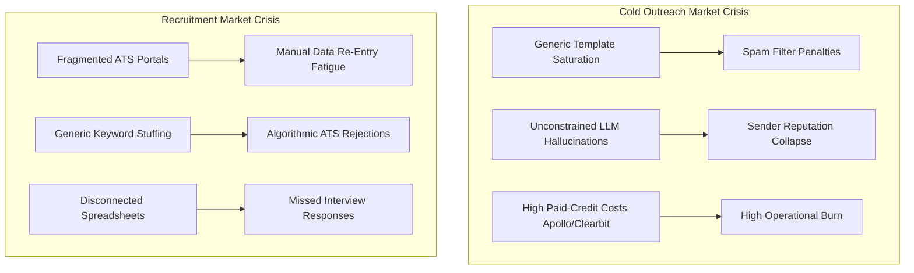
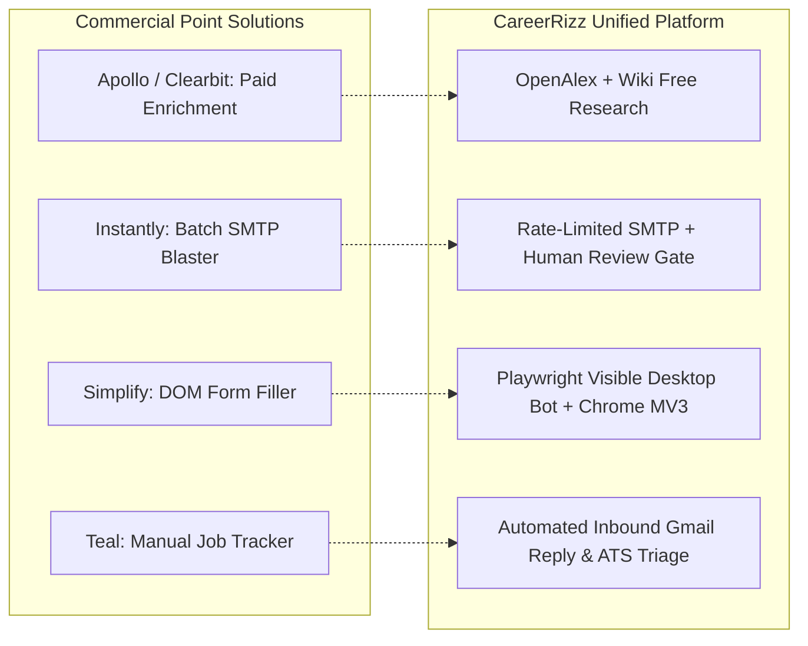

# Market Requirements Document (MRD)

**Project Name**: College Outreach Automation System V2 & CareerRizz  
**Document Version**: 2.0.0  
**Status**: Approved & Grounded to Workspace Baseline  
**Target Markets**: Higher Education Institutional Outreach & Autonomous Career Intelligence  

---

## 1. Executive Summary & Market Vision

The outbound communications and hiring markets are undergoing structural disruption driven by generative AI:
- In the **outbound email market**, massive volumes of generic, templated cold emails have caused open and reply rates to drop below 3%. Enterprise email providers (Google Workspace, Microsoft 365) have deployed aggressive behavioral spam filters penalizing repetitive templates. Current solutions (Instantly, Lemlist) provide sending scale but lack factual grounding, leading to high hallucination rates and reputational damage.
- In the **technical career recruitment market**, candidate application volume has surged 400% due to automated job board syndication, forcing hiring companies to deploy aggressive Applicant Tracking System (ATS) algorithmic screening. Job candidates face a fragmented landscape where each employer uses a different ATS portal (Greenhouse, Lever, Ashby, Workday), forcing 30–45 minutes of manual re-entry per application with low response rates.

**College Outreach Automation V2 / CareerRizz** captures this market opportunity by combining high-velocity automation with **verifiable factual evidence and deep semantic matching**. Operating as a dual-workspace platform, it delivers institutional outreach capabilities for academic departments and an autonomous, closed-loop career search platform for high-velocity candidates.

---

## 2. Market Problems & Industry Gaps



### Gap 1: The "Hallucinating AI" Outreach Flaw
Commercial sales engagement tools have added LLM personalization features, but they rely on ungrounded generation. When prompting an LLM to "write a personalized note to Dr. Smith," the model frequently fabricates research papers, claims nonexistent mutual acquaintances, or misattributes university affiliations. When discovered, this burns valuable academic and enterprise partnerships permanently.

### Gap 2: The Prohibitive Cost of Data Enrichment
Sales intelligence databases (Apollo.io, ZoomInfo, Clearbit) operate on expensive credit-based subscription models ($99–$499/month), charging $0.20 to $0.50 per verified email and profile. For university admissions teams, student organizations, and individual job seekers, these recurring costs are cost-prohibitive.

### Gap 3: The ATS Application "Black Hole"
Existing job search tools are split into disconnected silos:
- Job boards (LinkedIn, Indeed) offer broad discovery but lack tailoring.
- AI resume builders generate generic cover letters but cannot interact with ATS portals.
- Autofill browser extensions frequently break on complex multi-page portals like Workday or modern single-page applications like Ashby and Greenhouse.

---

## 3. Target Market Segments & Addressable Market

```text
┌────────────────────────────────────────────────────────────────────────┐
│                        TOTAL ADDRESSABLE MARKET (TAM)                  │
│       Global Higher Education Outbound Communications & Tech Hiring    │
└───────────────────────────────────┬────────────────────────────────────┘
                                    │
                                    ▼
┌────────────────────────────────────────────────────────────────────────┐
│                     SERVICEABLE ADDRESSABLE MARKET (SAM)               │
│   University Research Outreach, Admissions Partnerships & Tech Careers │
└───────────────────────────────────┬────────────────────────────────────┘
                                    │
                                    ▼
┌────────────────────────────────────────────────────────────────────────┐
│                    SERVICEABLE OBTAINABLE MARKET (SOM)                 │
│ Open-Access Academic Outreach Teams & Autonomous Engineering Job Hunt  │
└────────────────────────────────────────────────────────────────────────┘
```

### Segment A: Higher Education & Academic Institutions
- **Admissions & Recruitment**: Reaching out to high schools, community colleges, and international guidance counselors.
- **Academic Research & Lab Partnerships**: Faculty seeking co-authors, guest lecturers, conference keynote speakers, and corporate research sponsors.
- **University Career Centers & Alumni Relations**: Connecting with alumni on LinkedIn to secure corporate sponsorship, mentorship, and placement opportunities.

### Segment B: Technical Job Seekers & High-Velocity Engineers
- **Software Engineers, Data Scientists, and AI Researchers**: Candidates applying to 50–200 competitive openings across tech startups and enterprise firms.
- **Career Switchers & New Graduates**: Candidates needing dynamic ATS resume optimization to bypass automated algorithmic screening.

---

## 4. Competitive Analysis & Structural Differentiation

| Functional Area | Generic Cold Email Platforms (Instantly, Lemlist, Smartlead) | Consumer Career Extensions (Simplify, Teal, Huntr) | CareerRizz / College Outreach V2 (This Workspace) |
|---|---|---|---|
| **Data Enrichment Cost** | Paid 3rd-party credit subscriptions ($99+/mo) | None (User manually copies data) | **Zero-Cost Native APIs**: OpenAlex, Wikipedia, DuckDuckGo Lite. |
| **Evidence Traceability** | No evidence verification; purely synthetic text | N/A | **Cryptographic Fact Citation**: Every generated sentence is tied to verified fact IDs in `enrichment_results`. |
| **Safety & Review Flow** | Uncontrolled mass blast | Manual copy-paste | **Human-in-the-Loop Review Queue**: Dedicated approve/reject/edit queue with bulk release controls. |
| **Job Discovery Engine** | Not supported | Client-side scraping on job boards | **Official ATS REST Adapters**: Greenhouse, Lever, Ashby, Adzuna with canonical deduplication. |
| **Semantic Matching** | Not supported | Basic keyword density (TF-IDF) | **pgvector Cosine Distance** (1536-dim / 384-dim) + LLM Rubric Grading (0–100). |
| **Resume Formatting** | Not supported | Static PDF templates | **Dynamic Google XYZ Generator**: Programmatic conversion of achievements to FAANG 1-column format. |
| **Application Execution** | SMTP only | Form autofill script | **Triple Subsystem**: 1-Click Direct URL, Playwright Visible Desktop Bot (slow-mo), Chrome MV3 Extension. |
| **Inbound Reply Triage** | Basic open/click/reply tracking | None | **Dual-Purpose Gmail AI**: Sentiment triage + automatic ATS status progression (Interview, OA, Rejection). |

---

## 5. Core Value Propositions & Grounded Differentiation

### 1. Zero-Cost, Fact-Enriched Architecture
Instead of requiring expensive commercial enrichment APIs, the system directly leverages free, open-access knowledge graphs:
- **OpenAlex Works API**: Searches millions of open scholarly articles, returning verified paper titles, publication years, venues, and citation counts.
- **Wikipedia REST API**: Resolves verified biographical summaries for prominent academics, executives, and organizations.
- **DuckDuckGo Lite**: Queries real-time press releases and news without paid scraping infrastructure.

### 2. Verifiable Evidence Chain
The platform enforces that AI drafts cannot make unsupported claims. When generating an email, the LLM receives verified facts tagged with identifiers (`[FACT-1]`, `[FACT-2]`). The resulting draft records every cited fact in `personalization_results.evidence_used`. Human operators can inspect the exact evidence trace before approving.

### 3. Triple Application Execution Subsystem
Unlike browser extensions that frequently fail when confronting complex dynamic portals, the system provides three graduated execution tiers:
1. **1-Click Direct Apply**: Instant URL launch while recording application state.
2. **Playwright Live Desktop Bot**: Launches a visible Chromium window on the user's desktop with humanized slow-mo typing (50–150ms delay) and file attachment, staging the application for final user review.
3. **Chrome Manifest V3 Extension**: Injects a floating auto-fill widget directly into Greenhouse, Lever, Ashby, and Workday tabs, querying local candidate vault data.

### 4. Dual-Purpose Inbound Gmail Triage
The system's background reply daemon (`replies.job.js`) serves two simultaneous operational goals:
- For **Outreach**: Evaluates inbound replies against outreach campaigns, categorizing sentiment (`INTERESTED`, `INFO_REQUESTED`, `NOT_INTERESTED`) to alert operators.
- For **Career Search**: Detects incoming emails from ATS domains (`@greenhouse.io`, `@lever.co`, `@myworkday.com`, `@ashbyhq.com`), parses interview invitations or online assessments (OAs), and automatically updates application stages in the dashboard.

---

## 6. Grounded Feature Matrix vs. Market Alternatives



---

## 7. Economic & Cost Model

The system is architected for **near-zero operational overhead**, ensuring viability for bootstrapped teams, academic labs, and individual candidates:

| Cost Component | Commercial Market Cost | CareerRizz Workspace Cost | Cost Reduction |
|---|---|---|---|
| **Lead Enrichment** | $0.20 – $0.50 per contact (Apollo, ZoomInfo) | **$0.00** (OpenAlex & Wikipedia APIs are completely free) | **100% Free** |
| **Database & Vectors** | $50 – $200/mo (Pinecone, RDS Postgres) | **$0.00** (Supabase Free/Pro tier using native `pgvector`) | **90–100% Free** |
| **Email Relay** | $40 – $100/mo (SendGrid, Mailgun) | **$0.00 – $15/mo** (Brevo free tier 300 emails/day or low-tier SMTP) | **70–100% Free** |
| **LLM Inference** | $0.05 – $0.15 per generated draft | **$0.002 – $0.008** (Strict structured JSON outputs via OpenAI `gpt-4o-mini` / `gpt-4o`) | **90% Reduction** |
| **Application Bots** | $30 – $60/mo (Specialized autofill services) | **$0.00** (Native Playwright running on local desktop) | **100% Free** |

---

## 8. Go-to-Market (GTM) Strategy & Product Packaging

### Phase 1: Academic & University Department Adoption
- Target academic coordinators, university research directors, and student branch leaders.
- Value proposition: Ingest faculty directories and alumni rosters, research academic publications automatically, and generate verified, non-spam partnership outreach.

### Phase 2: High-Velocity Technical Career Hub
- Target software engineering candidates, graduate students, and bootcamp alumni.
- Value proposition: Autonomous ATS discovery, FAANG-standard dynamic ATS resume generation, visible desktop bot application execution, and automated interview tracking.

### Phase 3: Dual Workspace Synergies
- Unify under a single user profile supporting seamless switching between the `outreach` and `job_search` workspaces via the built-in React 19 console.

---

## 9. User Experience & Design Requirements

- **Design Framework**: React 19, TypeScript, Vite, Tailwind CSS v4, Radix UI headless primitives.
- **Theme Identity**: Enterprise dark-mode console (`bg-slate-950`, `border-slate-800`) with high-contrast indicator badges (`emerald` for approved/interested, `amber` for pending/followup, `rose` for rejected/suppressed).
- **Zero Mock Data Principle**: The primary frontend console (`f/`) strictly renders live backend API data with honest empty states, ensuring complete fidelity between dashboard metrics and database rows.
