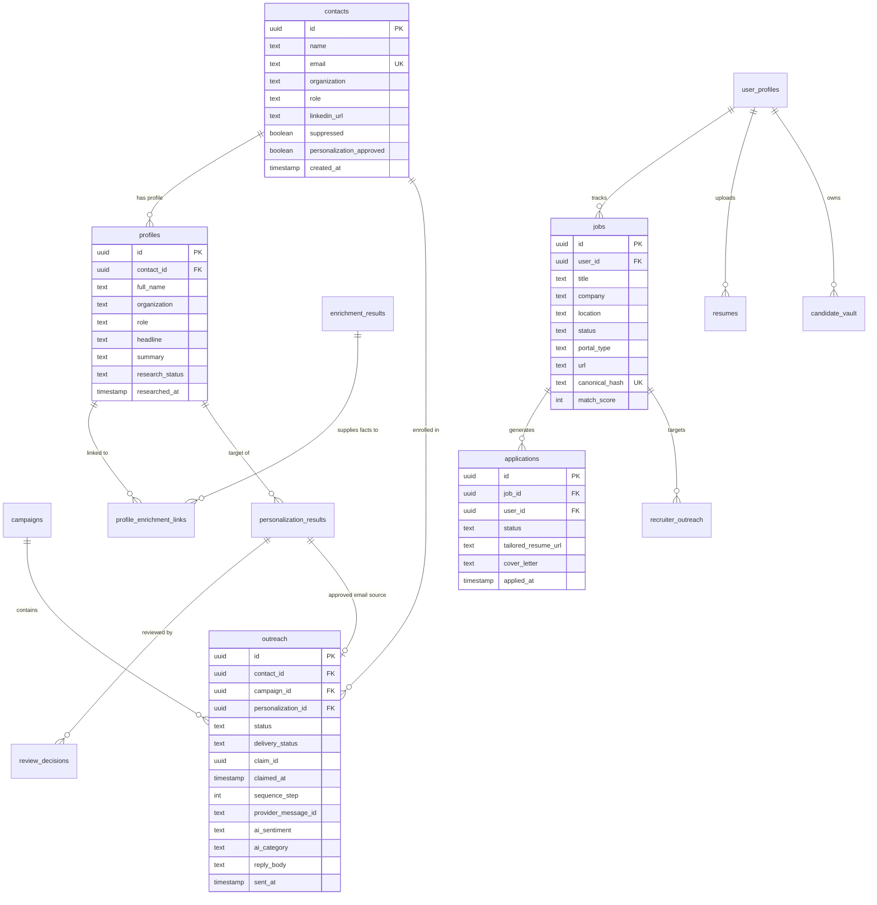

# Technical Requirements Document (TRD)

**Project Name**: College Outreach Automation System V2 & CareerRizz  
**Document Version**: 2.0.0  
**Status**: Approved & Grounded to Workspace Baseline  
**Target Systems**: Backend Core, Frontend Console, Monorepo Services, Extension & Playwright Bots  

---

## 1. System Technology Stack & Dependency Inventory

The application is engineered as a modern, high-throughput monorepo and microservices-ready architecture:

```text
┌───────────────────────────────────────────────────────────────────────────────────────┐
│                                FRONTEND CONSOLE (f/)                                  │
│  React 19.0.0 · TypeScript 5.7 · Vite 6.0 · Tailwind CSS v4.0 · Radix UI Primitives   │
│  Framer Motion · Lucide React · Supabase Realtime Client · Axios & Native Fetch       │
└──────────────────────────────────────────┬────────────────────────────────────────────┘
                                           │ HTTP/JSON + Supabase Realtime WS
                                           ▼
┌───────────────────────────────────────────────────────────────────────────────────────┐
│                              BACKEND API & ORCHESTRATION                              │
│  Node.js 20.x LTS (ESM) · Express 4.21.2 · Fastify 4.x (Monorepo Gateway)             │
│  Winston 3.17 Logger · Zod 3.24 Validation · node-cron 3.0.3 · BullMQ (Redis RESP)    │
└──────────────┬───────────────────────────┬───────────────────────────┬────────────────┘
               │                           │                           │
               ▼                           ▼                           ▼
┌──────────────────────────────┐ ┌───────────────────────────┐ ┌────────────────────────┐
│      DATABASE & VECTORS      │ │    AUTOMATION & PARSING   │ │   EXTERNAL INTEGRATIONS│
│ Supabase PostgreSQL          │ │ Playwright 1.64 (Chromium)│ │ OpenAI SDK 4.85        │
│ pgvector HNSW Index (1536d)  │ │ Chrome MV3 Extension      │ │ Nodemailer 6.10 (Brevo)│
│ Row-Level Security (RLS)     │ │ Tesseract.js 7.0 (OCR)    │ │ Google APIs 144 (Gmail)│
│ pgcrypto · pg_trgm           │ │ pdfjs-dist · pdf-parse    │ │ OpenAlex Works API     │
│ UUID Primary Keys            │ │ csv-parse 7.0 · xlsx 0.18 │ │ Wikipedia REST API     │
└──────────────────────────────┘ └───────────────────────────┘ │ Composio SDK 0.14      │
                                                               └────────────────────────┘
```

### 1.1 Complete Runtime & Dependency Specifications (`package.json`)

| Package / Tool | Version | Operational Purpose |
|---|---|---|
| **Node.js Runtime** | `20.x` (LTS) | Native ECMAScript Modules (`"type": "module"`), top-level await, native fetch. |
| **Express** | `^4.21.2` | Primary HTTP server hosting REST APIs, webhooks, and SPA static fallback middleware. |
| **@supabase/supabase-js**| `^2.48.1` | Postgres connection layer, GoTrue authentication, and Realtime event subscriptions. |
| **openai** | `^4.85.3` | Tiered LLM completions (`gpt-4o`, `gpt-4o-mini`) and vector embeddings (`text-embedding-3-small`). |
| **playwright** | `^1.64.1` | Visible desktop Chromium automation bot for live ATS application form-filling. |
| **tesseract.js** | `^7.0.0` | OCR extraction engine for scanned image rosters (.png, .jpg) and rasterized PDFs. |
| **pdfjs-dist** / **pdf-parse**| `^6.2.108` / `^1.1.1` | Multi-page text extraction for uploaded PDF resumes and directory files. |
| **csv-parse** / **xlsx** | `^7.0.2` / `^0.18.5` | Delimiter-agnostic CSV streaming parser and binary Excel spreadsheet reader. |
| **nodemailer** | `^6.10.1` | Outbound SMTP dispatch relay with delay jitter, concurrency caps, and headers. |
| **googleapis** | `^144.0.0` | Google Cloud OAuth 2.0 client for Gmail API inbox polling and message fetching. |
| **node-cron** | `^3.0.3` | Recurring in-process cron daemons for outreach, replies, cleanup, and autopilot. |
| **jsonwebtoken** | `^9.0.2` | HMAC-SHA256 signing and verification for one-click unsubscribe URLs. |
| **zod** | `^3.24.2` | Runtime schema validation for API payloads and LLM structured outputs. |
| **winston** | `^3.17.0` | Structured JSON application logger with file and console transports. |
| **@composio/core** | `0.14.1` | Unified integration bridge for user-scoped Gmail and LinkedIn connections. |
| **airtable** | `^0.12.2` | Read-only reporting mirror syncing Supabase outreach state to Airtable bases. |
| **multer** | `^2.2.0` | Multi-part form-data handler for resume and lead spreadsheet uploads. |

---

## 2. Comprehensive Database Architecture & Data Dictionary (27 Tables)

All schema definitions live in `db/migrations/*.sql` and `db/supabase_all_in_one_setup.sql`.



### Complete Schema Specifications (All 27 Tables)

#### 1. `contacts`
- Primary entity table for academic leads.
- `id` (UUID, PK, `gen_random_uuid()`), `name` (TEXT, NOT NULL), `email` (TEXT, UNIQUE, NOT NULL), `organization` (TEXT), `role` (TEXT), `personalization` (TEXT), `personalization_approved` (BOOLEAN, DEFAULT FALSE), `suppressed` (BOOLEAN, DEFAULT FALSE), `suppression_reason` (TEXT), `created_at` (TIMESTAMPTZ, DEFAULT NOW()), `updated_at` (TIMESTAMPTZ).

#### 2. `campaigns`
- Outbound outreach campaign definitions.
- `id` (UUID, PK), `name` (TEXT, NOT NULL), `subject_template` (TEXT), `body_template` (TEXT), `status` (TEXT, DEFAULT 'Draft'), `created_at` (TIMESTAMPTZ), `updated_at` (TIMESTAMPTZ).

#### 3. `profiles`
- Academic and institutional dossiers linked to contacts.
- `id` (UUID, PK), `contact_id` (UUID, FK $\rightarrow$ `contacts.id`), `full_name` (TEXT), `organization` (TEXT), `role` (TEXT), `linkedin_url` (TEXT), `headline` (TEXT), `summary` (TEXT), `research_status` (TEXT, DEFAULT 'pending'), `researched_at` (TIMESTAMPTZ), `created_at` (TIMESTAMPTZ), `updated_at` (TIMESTAMPTZ).

#### 4. `enrichment_sources`
- Registry of data providers.
- `id` (UUID, PK), `name` (TEXT, UNIQUE, e.g. 'openalex', 'wikipedia', 'duckduckgo'), `base_url` (TEXT), `rate_limit_per_minute` (INT), `status` (TEXT, DEFAULT 'active').

#### 5. `enrichment_results`
- Factual claims extracted from external APIs.
- `id` (UUID, PK), `source_id` (UUID, FK $\rightarrow$ `enrichment_sources.id`), `external_id` (TEXT), `fact_type` (TEXT, e.g. 'publication', 'bio', 'news'), `title` (TEXT), `snippet` (TEXT, NOT NULL), `raw_payload` (JSONB), `confidence_score` (FLOAT), `created_at` (TIMESTAMPTZ).

#### 6. `profile_enrichment_links`
- Junction mapping profiles to verified facts.
- `profile_id` (UUID, FK $\rightarrow$ `profiles.id`), `enrichment_result_id` (UUID, FK $\rightarrow$ `enrichment_results.id`), `PRIMARY KEY(profile_id, enrichment_result_id)`.

#### 7. `personalization_results`
- AI-generated drafts citing verified evidence.
- `id` (UUID, PK), `profile_id` (UUID, FK $\rightarrow$ `profiles.id`), `campaign_id` (UUID, FK $\rightarrow$ `campaigns.id`), `subject_line` (TEXT, NOT NULL), `body_content` (TEXT, NOT NULL), `evidence_used` (JSONB, array of fact IDs), `quality_score` (INT), `status` (TEXT, DEFAULT 'pending_review'), `created_at` (TIMESTAMPTZ).

#### 8. `review_decisions`
- Audit trail of operator review actions.
- `id` (UUID, PK), `personalization_id` (UUID, FK $\rightarrow$ `personalization_results.id`), `decided_by` (UUID, FK $\rightarrow$ `contacts.id`), `decision` (TEXT, 'approve' | 'reject' | 'edit_and_approve'), `comments` (TEXT), `created_at` (TIMESTAMPTZ).

#### 9. `outreach`
- Central transaction state for email sending.
- `id` (UUID, PK), `contact_id` (UUID, FK $\rightarrow$ `contacts.id`), `campaign_id` (UUID, FK $\rightarrow$ `campaigns.id`), `personalization_id` (UUID, FK $\rightarrow$ `personalization_results.id`), `status` (TEXT, 'Ready' | 'Claimed' | 'Sent' | 'Replied' | 'Failed'), `delivery_status` (TEXT, 'Pending' | 'Delivered' | 'Bounced'), `claim_id` (UUID), `claimed_at` (TIMESTAMPTZ), `sequence_step` (INT, DEFAULT 0), `provider_message_id` (TEXT), `gmail_thread_id` (TEXT), `reply_body` (TEXT), `ai_category` (TEXT), `ai_sentiment` (TEXT), `ai_summary` (TEXT), `ai_next_action` (TEXT), `sent_at` (TIMESTAMPTZ), `created_at` (TIMESTAMPTZ).

#### 10. `processed_gmail_messages`
- High-water mark deduplication index.
- `message_id` (TEXT, PK), `processed_at` (TIMESTAMPTZ, DEFAULT NOW()).

#### 11. `import_jobs`
- Asynchronous file import tracking.
- `id` (UUID, PK), `filename` (TEXT), `file_type` (TEXT), `total_rows` (INT), `processed_rows` (INT), `created_count` (INT), `updated_count` (INT), `error_count` (INT), `status` (TEXT, 'queued' | 'processing' | 'completed' | 'failed'), `error_log` (JSONB), `created_at` (TIMESTAMPTZ).

#### 12. `user_profiles`
- RBAC permissions and session workspace state.
- `id` (UUID, PK, matches `auth.users.id`), `email` (TEXT), `role` (TEXT, 'owner' | 'college_operator' | 'job_seeker'), `enabled_modules` (TEXT[], DEFAULT '{"outreach"}'), `active_workspace` (TEXT, DEFAULT 'outreach'), `created_at` (TIMESTAMPTZ).

#### 13. `jobs`
- Tracked career opportunities.
- `id` (UUID, PK), `user_id` (UUID, FK $\rightarrow$ `user_profiles.id`), `title` (TEXT, NOT NULL), `company` (TEXT, NOT NULL), `location` (TEXT), `url` (TEXT), `portal_type` (TEXT, 'greenhouse' | 'lever' | 'ashby' | 'workday'), `salary_range` (TEXT), `status` (TEXT, 'discovered' | 'researching' | 'applying' | 'applied' | 'interviewing' | 'rejected' | 'offered'), `match_score` (INT), `canonical_hash` (TEXT, UNIQUE), `notes` (TEXT), `created_at` (TIMESTAMPTZ), `updated_at` (TIMESTAMPTZ).

#### 14. `applications`
- Executed job applications.
- `id` (UUID, PK), `job_id` (UUID, FK $\rightarrow$ `jobs.id`), `user_id` (UUID, FK $\rightarrow$ `user_profiles.id`), `status` (TEXT, 'draft' | 'ready' | 'applied' | 'interview' | 'technical_round' | 'rejected' | 'offer'), `tailored_resume_url` (TEXT), `cover_letter` (TEXT), `notes` (TEXT), `applied_at` (TIMESTAMPTZ), `created_at` (TIMESTAMPTZ).

#### 15. `recruiter_outreach`
- Recruiter cold outreach correspondence.
- `id` (UUID, PK), `user_id` (UUID, FK $\rightarrow$ `user_profiles.id`), `job_id` (UUID, FK $\rightarrow$ `jobs.id`), `recruiter_name` (TEXT), `recruiter_email` (TEXT), `channel` (TEXT, 'email' | 'linkedin'), `status` (TEXT, 'draft' | 'sent' | 'replied'), `sent_at` (TIMESTAMPTZ).

#### 16. `resumes`
- Candidate resumes with extracted text and embeddings.
- `id` (UUID, PK), `user_id` (UUID, FK $\rightarrow$ `user_profiles.id`), `filename` (TEXT), `file_url` (TEXT), `extracted_text` (TEXT), `skills` (TEXT[]), `embedding` (`vector(1536)`), `created_at` (TIMESTAMPTZ).

#### 17. `candidate_vault`
- Granular candidate atomic experience blocks.
- `id` (UUID, PK), `user_id` (UUID, FK $\rightarrow$ `user_profiles.id`), `category` (TEXT, 'experience' | 'project' | 'skill' | 'education' | 'metric'), `content` (TEXT, NOT NULL), `tags` (TEXT[]), `metadata` (JSONB), `created_at` (TIMESTAMPTZ).

#### 18. `candidate_profiles`
- Enterprise monorepo candidate preferences.
- `id` (UUID, PK), `user_id` (UUID, FK $\rightarrow$ `user_profiles.id`), `target_titles` (TEXT[]), `target_locations` (TEXT[]), `min_salary` (INT), `autopilot_enabled` (BOOLEAN, DEFAULT FALSE).

#### 19. `job_listings`
- Aggregated de-duplicated global job board postings.
- `id` (UUID, PK), `title` (TEXT), `company` (TEXT), `location` (TEXT), `description` (TEXT), `url` (TEXT), `canonical_hash` (TEXT, UNIQUE), `created_at` (TIMESTAMPTZ).

#### 20. `job_sources`
- External ATS endpoint health and metrics.
- `id` (UUID, PK), `name` (TEXT), `adapter_type` (TEXT), `fetch_interval_seconds` (INT), `last_synced_at` (TIMESTAMPTZ).

#### 21. `job_snapshots`
- Historical DOM and text snapshots of job postings.
- `id` (UUID, PK), `job_listing_id` (UUID, FK $\rightarrow$ `job_listings.id`), `raw_html` (TEXT), `captured_at` (TIMESTAMPTZ).

#### 22. `job_research`
- Synthesized company intelligence dossiers.
- `id` (UUID, PK), `company_name` (TEXT), `tech_stack` (TEXT[]), `funding_stage` (TEXT), `culture_summary` (TEXT), `created_at` (TIMESTAMPTZ).

#### 23. `job_matches`
- Semantic match scores and rubric breakdowns.
- `id` (UUID, PK), `candidate_id` (UUID, FK $\rightarrow$ `candidate_profiles.id`), `job_listing_id` (UUID, FK $\rightarrow$ `job_listings.id`), `overall_score` (INT), `explanation` (JSONB).

#### 24. `agent_runs`
- Orchestrator execution logs.
- `id` (UUID, PK), `agent_name` (TEXT), `status` (TEXT), `tokens_used` (INT), `duration_ms` (INT), `created_at` (TIMESTAMPTZ).

#### 25. `audit_log`
- System-wide mutation tracking.
- `id` (UUID, PK), `user_id` (UUID), `action` (TEXT), `entity_type` (TEXT), `entity_id` (UUID), `payload` (JSONB), `created_at` (TIMESTAMPTZ).

#### 26. `source_configs`
- Scraper header and rate-limit overrides.
- `id` (UUID, PK), `source_id` (UUID, FK $\rightarrow$ `job_sources.id`), `concurrency_limit` (INT), `headers` (JSONB).

#### 27. `job_embeddings`
- Vector embeddings for high-dimensional semantic search.
- `id` (UUID, PK), `job_id` (UUID, FK $\rightarrow$ `jobs.id`), `embedding` (`vector(384)` or `vector(1536)`). Index: HNSW `vector_cosine_ops`.

---

## 3. Full REST API Route Registry & Contracts (40+ Endpoints)

All endpoints mounted under `/api` require authentication via Supabase JWT or `x-api-key`.

### Module 1: Institutional Outreach Routes (`requireModule('outreach')`)

#### `POST /api/import`
- **Purpose**: Uploads and queues a lead file for asynchronous processing.
- **Request**: Multipart form-data with field `file` (.csv, .xlsx, .pdf, image).
- **Responses**: `200 OK` $\rightarrow$ `{ success: true, jobId: "uuid", totalRows: 45 }`, `400 Bad Request`.

#### `GET /api/import/status/:jobId`
- **Purpose**: Polls import progress and row errors.
- **Response**: `200 OK` $\rightarrow$ `{ id: "uuid", status: "completed", processedRows: 45, createdCount: 42, errorCount: 3 }`.

#### `GET /api/dashboard/stats`
- **Purpose**: Retrieves aggregate outreach statistics and hourly delivery trends.
- **Response**: `200 OK` $\rightarrow$ `{ totalLeads: 250, sentCount: 180, replyCount: 32, bounceCount: 2, hourlyDelivery: [...] }`.

#### `GET /api/profiles`
- **Purpose**: Returns enriched academic profiles with linked fact counts.
- **Response**: `200 OK` $\rightarrow$ `[{ id: "uuid", fullName: "Dr. Jane Doe", organization: "Stanford", factsCount: 7 }]`.

#### `POST /api/research/:profileId/run`
- **Purpose**: Triggers synchronous web research against OpenAlex, Wikipedia, and DuckDuckGo.
- **Response**: `200 OK` $\rightarrow$ `{ success: true, factsExtracted: 5, confidence: 0.92 }`.

#### `GET /api/review/queue`
- **Purpose**: Fetches drafts awaiting human operator review.
- **Response**: `200 OK` $\rightarrow$ `[{ id: "uuid", profile: {...}, subject: "...", body: "...", evidenceUsed: ["FACT-1"] }]`.

#### `POST /api/review/:personalizationId`
- **Purpose**: Submits review decision for a draft.
- **Payload**: `{ decision: "approve" | "reject" | "edit_and_approve", comments?: string, editedSubject?: string, editedBody?: string }`.
- **Response**: `200 OK` $\rightarrow$ `{ success: true, status: "approved" }`.

#### `POST /api/bulk/approve-and-send`
- **Purpose**: 1-click bulk approval of up to 50 pending drafts.
- **Payload**: `{ campaignId?: string, personalizationIds?: string[], limit?: number }`.
- **Response**: `200 OK` $\rightarrow$ `{ success: true, approvedCount: 25, queuedForDispatch: 25 }`.

#### `GET /api/replies`
- **Purpose**: Returns all received emails with AI sentiment classification.
- **Response**: `200 OK` $\rightarrow$ `[{ id: "uuid", from: "...", sentiment: "positive", category: "INTERESTED", summary: "..." }]`.

#### `POST /api/alumni/discover`
- **Purpose**: Scrapes LinkedIn for alumni of a target school via Apify.
- **Payload**: `{ school: "MIT", maxResults: 15, location: "San Francisco" }`.
- **Response**: `200 OK` $\rightarrow$ `{ success: true, count: 15, candidates: [...] }`.

---

### Module 2: Career Search & Application Routes (`requireModule('job_search')`)

#### `GET /api/jobs`
- **Purpose**: Retrieves tracked job opportunities.
- **Response**: `200 OK` $\rightarrow$ `[{ id: "uuid", title: "Senior AI Engineer", company: "Anthropic", status: "discovered", matchScore: 92 }]`.

#### `POST /api/jobs/discover`
- **Purpose**: Queries Greenhouse, Lever, Ashby, and Adzuna APIs for open listings.
- **Payload**: `{ query: "Software Engineer", location: "Remote", portalType: "greenhouse" }`.
- **Response**: `200 OK` $\rightarrow$ `{ success: true, discoveredCount: 18 }`.

#### `POST /api/resumes/upload`
- **Purpose**: Uploads master resume PDF and extracts plain text.
- **Request**: Multipart form-data with field `resume`.
- **Response**: `201 Created` $\rightarrow$ `{ success: true, resumeId: "uuid", extractedLength: 3450, skillsFound: [...] }`.

#### `POST /api/jobs/:id/match`
- **Purpose**: Computes 0–100 rubric match score between resume and job description.
- **Response**: `200 OK` $\rightarrow$ `{ matchScore: 88, breakdown: { skills: 90, experience: 85 }, strengths: [...], gaps: [...] }`.

#### `POST /api/jobs/:id/generate-ats-resume`
- **Purpose**: Generates FAANG 1-column ATS resume using Google XYZ bullet points.
- **Response**: `200 OK` $\rightarrow$ `{ atsPassScore: 94, keywordsExtracted: [...], markdownContent: "..." }`.

#### `POST /api/jobs/:id/personalize`
- **Purpose**: Drafts tailored cover letter in 1 of 4 tones (`professional`, `conversational`, `technical`, `punchy`).
- **Payload**: `{ tone: "technical" }`.
- **Response**: `200 OK` $\rightarrow$ `{ coverLetter: "...", citedCompanyFacts: [...] }`.

#### `POST /api/jobs/:id/apply-live`
- **Purpose**: Launches visible desktop Chromium Playwright bot to fill ATS form.
- **Payload**: `{ autoSubmit: false }`.
- **Response**: `200 OK` $\rightarrow$ `{ success: true, mode: "visible_desktop", fieldsPopulated: 12, readyToSubmit: true }`.

#### `POST /api/jobs/autopilot/run`
- **Purpose**: Triggers 1 complete background cycle of the autonomous discovery-match-apply daemon.
- **Response**: `200 OK` $\rightarrow$ `{ success: true, summary: { discovered: 14, matched: 4, applied: 2, repliesChecked: 1 } }`.

#### `GET /api/candidate-vault`
- **Purpose**: Returns atomic candidate experience and skill blocks.
- **Response**: `200 OK` $\rightarrow$ `[{ id: "uuid", category: "experience", content: "Scaled Redis cluster to 2M ops/sec", tags: ["Redis", "Distributed Systems"] }]`.

---

## 4. Background Jobs & Worker Architecture

All daemons are initialized in `src/server.js` using `node-cron`:

```text
┌────────────────────────────┬──────────────────┬─────────────────────────────────────────────────────────┐
│ Job Name                   │ Cron Schedule    │ Core Operation & Failure Recovery                       │
├────────────────────────────┼──────────────────┼─────────────────────────────────────────────────────────┤
│ send-outreach.job.js       │ */2 * * * *      │ Claims up to DAILY_SEND_LIMIT Ready rows; sends via     │
│                            │ (Every 2 min)    │ Nodemailer with 2000ms delay jitter; halts on cap.      │
├────────────────────────────┼──────────────────┼─────────────────────────────────────────────────────────┤
│ followups.job.js           │ 0 */6 * * *      │ Queries sent outreach older than 7 or 14 days without   │
│                            │ (Every 6 hrs)    │ replies; plans Step 1 or Step 2 follow-ups.             │
├────────────────────────────┼──────────────────┼─────────────────────────────────────────────────────────┤
│ replies.job.js             │ */15 * * * *     │ Fetches unread Gmail messages; deduplicates against     │
│                            │ (Every 15 min)   │ processed_gmail_messages; classifies reply sentiment.  │
├────────────────────────────┼──────────────────┼─────────────────────────────────────────────────────────┤
│ airtable-sync.job.js       │ 0 * * * *        │ Read-only mirror syncing Supabase outreach state to     │
│                            │ (Hourly)         │ Airtable base for non-technical stakeholders.           │
├────────────────────────────┼──────────────────┼─────────────────────────────────────────────────────────┤
│ cleanup-stale-claims.job.js│ */10 * * * *     │ Resets outreach rows where status = 'Claimed' and       │
│                            │ (Every 10 min)   │ claimed_at < NOW() - 10 minutes back to 'Ready'.        │
├────────────────────────────┼──────────────────┼─────────────────────────────────────────────────────────┤
│ import.job.js              │ */5 * * * *      │ Picks up queued import_jobs; extracts buffers and       │
│                            │ (Every 5 min)    │ batch-inserts contacts and academic profiles.           │
├────────────────────────────┼──────────────────┼─────────────────────────────────────────────────────────┤
│ personalization.job.js     │ */30 * * * *     │ Scans un-personalized profiles; runs research if        │
│                            │ (Every 30 min)   │ missing; calls OpenAI to draft cited emails.            │
├────────────────────────────┼──────────────────┼─────────────────────────────────────────────────────────┤
│ job-autopilot.job.js       │ */30 * * * *     │ Runs 30-min discovery, matching, and auto-apply cycle;  │
│                            │ (Every 30 min)   │ checks Gmail for company ATS responses.                 │
└────────────────────────────┴──────────────────┴─────────────────────────────────────────────────────────┘
```

---

## 5. Execution Subsystems: Playwright Bot & Chrome Extension Bridge

### 5.1 Playwright Desktop Bot (`src/services/workers/execution/playwright-live-bot.js`)
- **Execution Mode**: Visible non-headless Chromium (`headless: false`, `slowMo: 40`).
- **Anti-Bot Flags**: Launches with `--disable-blink-features=AutomationControlled` and custom user-agent string.
- **Form Pacing**: Character-by-character input typing with randomized 50–150ms delays.
- **Selector Detection Hierarchy**:
  - Full Name / First Name / Last Name
  - Email / Phone Number
  - LinkedIn / GitHub / Portfolio URLs
  - Resume file input (`input[type="file"]`)
- **Safety Staging**: Populates all inputs and uploads resume, stopping before clicking submit to preserve user control.

### 5.2 Chrome Extension Manifest V3 Bridge (`src/extension/`)
- **Permissions**: `alarms`, `tabs`, `scripting`, `activeTab`, `storage`.
- **Target Domains**: Injects `content-autofill.js` into:
  - `https://*.greenhouse.io/*`
  - `https://*.lever.co/*`
  - `https://*.ashbyhq.com/*`
  - `https://*.myworkdayjobs.com/*`
- **UI Widget**: Injects floating "Auto-Fill via CareerRizz" button.
- **Data Bridge**: Queries local session API (`/api/candidate-vault/query`) to fetch candidate credentials and populate active inputs.

---

## 6. AI & Semantic Search Pipelines

### 6.1 LLM Gating & Prompts
- **Personalization**: `gpt-4o` enforcing JSON output with cited fact IDs.
- **Reply Classifier**: `gpt-4o-mini` with strict categorization prompt returning `category`, `confidence`, `sentiment`, `summary`, `nextAction`.
- **ATS Resume Bullet Optimization**: Formats achievements into Google XYZ formulas: *"Accomplished [X], as measured by [Y], by doing [Z]"*.

### 6.2 Vector Search Architecture
- **Embedding Model**: OpenAI `text-embedding-3-small` (1536 dims) or BAAI `bge-small-en-v1.5` (384 dims).
- **HNSW Index Schema**:
  ```sql
  CREATE INDEX IF NOT EXISTS idx_job_embeddings_hnsw 
  ON job_embeddings USING hnsw (embedding vector_cosine_ops);
  ```
- **Cosine Distance Calculation**:
  ```sql
  SELECT id, title, company, 1 - (embedding <=> $1) AS similarity_score
  FROM job_embeddings
  WHERE 1 - (embedding <=> $1) > 0.75
  ORDER BY similarity_score DESC
  LIMIT 10;
  ```

---

## 7. Security Architecture, Authentication & Unsubscribe Cryptography

### 7.1 Middleware Chain
1. `requireAuth`: Verifies Supabase GoTrue JWT Bearer tokens in `Authorization` header.
2. `requireApiKey`: Verifies `x-api-key` against `ADMIN_API_KEY`.
3. `x-bypass-auth`: Dev-only bypass. Strictly disabled when `NODE_ENV === 'production'`.
4. `requireModule(moduleName)`: Verifies role permissions in `user_profiles`, enforcing module isolation.

### 7.2 Cryptographic Unsubscribe System
- Signs token using `UNSUBSCRIBE_JWT_SECRET`:
  ```javascript
  jwt.sign({ contactId: contact.id, email: contact.email }, config.security.unsubscribeJwtSecret, { expiresIn: '90d' });
  ```
- Injects standard RFC 8058 headers:
  ```text
  List-Unsubscribe: <http://localhost:5000/unsubscribe?token=...>, <mailto:unsubscribe@domain.com?subject=unsubscribe:...>
  List-Unsubscribe-Post: List-Unsubscribe=One-Click
  ```

---

## 8. Environment & Infrastructure Configuration

### Environment Variables Catalog (`src/config/env.js`)

| Variable Name | Required | Default | Operational Purpose |
|---|---|---|---|
| `PORT` | No | `5000` | HTTP server port |
| `NODE_ENV` | No | `'development'` | Environment mode ('development' \| 'production') |
| `BASE_URL` | No | `'http://localhost:5000'` | Base public URL for OAuth callbacks and unsubscribe links |
| `SUPABASE_URL` | **Yes** | `''` | Supabase project API URL |
| `SUPABASE_SERVICE_KEY` | **Yes** | `''` | Service role key (bypasses RLS) |
| `SUPABASE_ANON_KEY` | **Yes** | `''` | Anonymous public client key |
| `SMTP_HOST` | **Yes** | `'smtp.mailtrap.io'` | Outbound SMTP relay hostname |
| `SMTP_PORT` | **Yes** | `587` | Outbound SMTP port |
| `SMTP_USER` | **Yes** | `''` | SMTP authentication user |
| `SMTP_PASS` | **Yes** | `''` | SMTP authentication password |
| `MAIL_FROM_EMAIL` | **Yes** | `'shahid@gmail.com'` | Sender email address |
| `MAIL_FROM_NAME` | No | `'Shahid'` | Sender name |
| `GMAIL_CLIENT_ID` | No | `''` | Google OAuth client ID |
| `GMAIL_CLIENT_SECRET` | No | `''` | Google OAuth client secret |
| `GMAIL_REDIRECT_URI` | No | `'http://localhost:5000/auth/google/callback'` | OAuth redirect callback |
| `GMAIL_REFRESH_TOKEN` | No | `''` | Offline refresh token for Gmail API |
| `OPENAI_API_KEY` | **Yes** | `''` | OpenAI API key |
| `OPENAI_MODEL` | No | `'gpt-4o'` | Model selection for drafts |
| `DAILY_SEND_LIMIT` | No | `10` | Daily sending cap |
| `SEND_DELAY_MS` | No | `2000` | Jitter delay between emails (ms) |
| `SMTP_CONCURRENCY` | No | `1` | Max parallel SMTP sockets |
| `PERSONALIZATION_CONCURRENCY` | No | `5` | Max parallel OpenAI calls |
| `RESEARCH_CONCURRENCY` | No | `3` | Max parallel web research calls |
| `ADMIN_API_KEY` | No | `'dev_admin_key_123'` | Static API key |
| `UNSUBSCRIBE_JWT_SECRET` | No | `'super_secret_unsubscribe_jwt_key'` | Secret for signing unsubscribe JWTs |

### Verification & Testing Commands
- **Syntax Check**: `node --check src/server.js`
- **Unit Verification**: `node test-verification.js`
- **Test Suite**: `npm test` (`test/careerrizz-core.test.js`, `test/composio.test.js`)
- **Frontend Build**: `cd f && npm run build`
